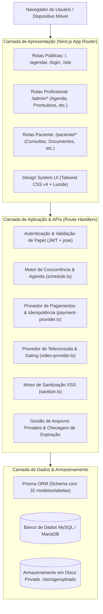
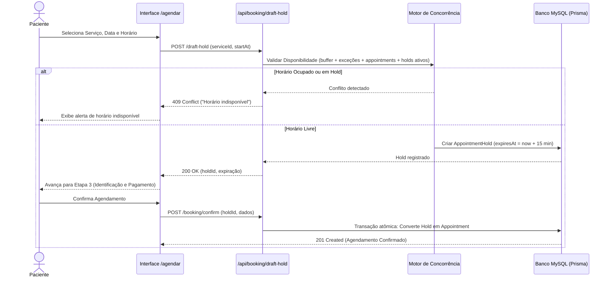

# PSI — Arquitetura do Sistema e Especificação Técnica

O **PSI** é um sistema de gestão de consultórios projetado especificamente para psicólogos e psiquiatras, estruturado como uma aplicação *single-tenant* (instalação independente por profissional) em Next.js com App Router e banco de dados relacional MySQL/MariaDB gerenciado via Prisma ORM.

---

## 1. Visão Geral da Arquitetura

O sistema adota uma arquitetura em camadas monolítica limpa, isolando regras de negócio em módulos de serviço reutilizáveis e protegendo dados sensíveis no backend através de autorização mandatória no servidor.

---

## 2. Camadas do Sistema

### 2.1 Camada de Apresentação (App Router)
- **Rotas Públicas:** `/`, `/site`, `/agendar`, `/login`, `/cadastro`, `/recuperar-senha`, `/privacidade`, `/termos`, `/cookies`, `/lgpd`.
- **Área Administrativa (`/admin`):**
  - `/admin`: Dashboard executivo com métricas financeiras, taxa de no-show e agendamentos recentes.
  - `/admin/agenda`: Gestão visual de consultas, status, cancelamentos tardios e faltas.
  - `/admin/servicos`: CRUD de modalidades, durações e buffers de transição.
  - `/admin/pacientes`: Prontuário cadastral, aprovação de dados de menores e alterações pendentes.
  - `/admin/prontuarios`: Registro de evolução clínica com versionamento e escala visual de humor.
  - `/admin/financeiro`: Fluxo de caixa, conciliação manual e estornos.
  - `/admin/pacotes`: Criação e acompanhamento de propostas de pacotes.
  - `/admin/minisite`: Customização da página inicial com pré-visualização e sanitização.
  - `/admin/arquivos`: Monitoramento de disco e backup com checksum SHA-256.
  - `/admin/configuracoes`: Parâmetros técnicos, fuso horário, teleconsulta e notificações.
- **Área do Paciente (`/paciente`):**
  - `/paciente`: Próximas consultas, link direto para teleconsulta no horário permitido.
  - `/paciente/perfil`: Atualização cadastral com fluxo de aprovação para dados sensíveis.
  - `/paciente/anamnese`: Preenchimento e envio de questionário inicial.
  - `/paciente/financeiro`: Histórico de pagamentos e aceite de pacotes de sessões.
  - `/paciente/documentos`: Download seguro de recibos e atestados compartilhados pelo profissional.

---

## 3. Fluxo de Agendamento e Concorrência

Para evitar sobreposição de horários (*race conditions*) entre múltiplos pacientes ou entre a agenda pública e o profissional, o PSI utiliza validação transacional e reservas temporárias (*Draft Holds*).

---

## 4. Modelo de Segurança e Isolamento

1. **Autenticação:**
   - Tokens JWT assinados com algoritmo HMAC SHA-256 (`HS256`) via biblioteca nativa `jose`.
   - Armazenamento em cookie HTTP-Only (`psi_token`), com flags `SameSite=Lax` e `Secure` em produção.
   - Proteção contra força bruta: bloqueio automático após 5 tentativas consecutivas com bloqueio de 15 minutos e limpeza após sucesso.
2. **Autorização Mandatória no Servidor:**
   - Funções auxiliares `getCurrentUser()` verificam a assinatura do token e extraem o identificador e papel.
   - Chamadas a prontuários ou rotas de gestão administrativa rejeitam imediatamente qualquer usuário cujo papel não seja `ADMIN`.
   - Chamadas na área do paciente exigem que `session.patientId` corresponda exatamente ao recurso solicitado.
3. **Isolamento de Arquivos Privados:**
   - Nenhum documento clínico ou anexo é salvo dentro da pasta `public/`.
   - Todos os arquivos residem em `./storage/uploads/` e são nomeados com UUIDs aleatórios.
   - O acesso é intermediado pela rota `/api/files/[id]/download`, que valida propriedade, perfil e expiração do compartilhamento. Proteção estrita contra *path traversal* via `path.resolve` e `path.basename`.
4. **Sanitização de HTML:**
   - Conteúdos do MiniSite são higienizados por regex e parser de tags (`src/lib/sanitize.ts`), eliminando scripts, tags perigosas (`<object>`, `<embed>`, `<base>`) e atributos `javascript:` ou *event handlers* (`onclick`, etc.).
5. **Monitoramento Técnico Seguro:**
   - Rota `/api/technical/status` exposta apenas via método `GET`, protegida por `Authorization: Bearer <TOKEN>`.
   - Retorna métricas do sistema agregadas sem jamais expor dados pessoais de pacientes, senhas ou dados clínicos.
