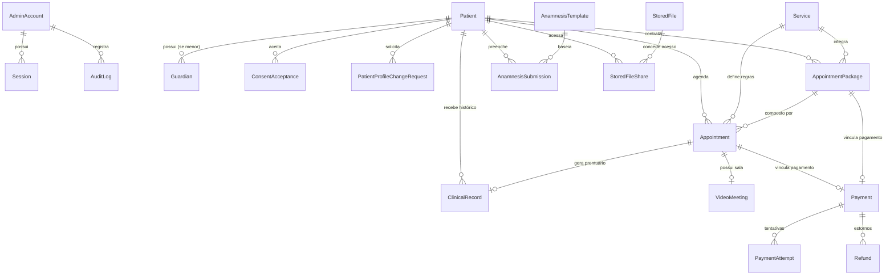

# PSI — Arquitetura de Banco de Dados e Modelagem Relacional (DATABASE.md)

Este documento especifica o modelo relacional de dados do **PSI — Sistema de Gestão de Consultórios**, seus relacionamentos, índices, regras de integridade e invariantes de domínio.

---

## 1. Princípios de Modelagem

1. **Separação de Ciclos de Vida:**
   - O status do agendamento (`AppointmentStatus`: `PENDING_CONFIRMATION`, `CONFIRMED`, `COMPLETED`, `CANCELLED`, `LATE_CANCELLED`, `NO_SHOW`) **não** é sobrecarregado com status financeiro ou de teleconsulta.
   - O status do pagamento (`PaymentStatus`: `PENDING`, `APPROVED`, `REJECTED`, `CANCELLED`, `REFUNDED`) possui seu próprio ciclo de vida e histórico de tentativas (`PaymentAttempt`) e estornos (`Refund`).
   - A aceitação de pacotes (`PackageAcceptanceStatus`: `PROPOSED`, `ACCEPTED`, `REJECTED`, `EXPIRED`) e a presença do paciente são entidades distintas.

2. **Precisão Monetária e Temporal:**
   - Todos os valores financeiros são armazenados como **inteiros em centavos de Real (`Int` representando BRL cents)**. Ex: R$ 150,00 = `15000`.
   - Todas as datas e horas são armazenadas em UTC (`DateTime`). O fuso horário operacional do profissional é lido da configuração do sistema (`timezone`, ex: `America/Sao_Paulo`) para cálculo de regras de disponibilidade e exibição.

3. **Prevenção de Colisões e Concorrência:**
   - `AppointmentHold`: Tabela de pré-reservas atômicas com `expiresAt` e `holdToken` único para evitar colisões entre agendamentos online simultâneos e propostas de pacotes.
   - Verificação em nível de transação no banco de dados (`$transaction`) comparando intervalos abertos `(startAt < existingEndAt AND endAt > existingStartAt)`.

---

## 2. Entidades Principais e Relacionamentos

---

## 3. Descrição Detalhada dos Modelos

### 3.1 Autenticação e Administrador
- `AdminAccount`: Dados do profissional titular (`id`, `name`, `email`, `passwordHash`, `phone`, `crpCrm`, `mustChangePassword`, `failedLogins`, `lockedUntil`, `createdAt`, `updatedAt`).
- `Session`: Sessões ativas autenticadas (`id`, `token`, `userId`, `userRole`, `expiresAt`, `ipAddress`, `userAgent`).

### 3.2 Pacientes e Responsáveis
- `Patient`: Cadastro completo do paciente (`id`, `fullName`, `email`, `passwordHash`, `phone`, `cpf`, `birthDate`, `isMinor`, `gender`, `address`, `emergencyContact`, `isActive`, `createdAt`, `updatedAt`).
- `Guardian`: Dados do responsável legal caso o paciente seja menor (`id`, `patientId`, `fullName`, `cpf`, `phone`, `email`, `relationship`).
- `PatientProfileChangeRequest`: Histórico de solicitações de alteração de dados sensíveis (`id`, `patientId`, `field`, `oldValue`, `newValue`, `status`, `reviewedAt`, `reviewedBy`).
- `PatientEmailChangeToken`: Tokens temporários e criptografados (SHA-256) para validação autônoma e segura de troca de e-mail (`id`, `patientId`, `oldEmail`, `newEmail`, `tokenHash`, `expiresAt`, `usedAt`, `ipAddress`, `createdAt`).
- `ConsentAcceptance`: Aceite formal de termos e políticas LGPD (`id`, `patientId`, `policyType`, `policyVersion`, `ipAddress`, `acceptedAt`).

### 3.3 Serviços e Disponibilidade
- `Service`: Catálogo de procedimentos (`id`, `name`, `description`, `priceCents`, `isFree`, `durationMinutes`, `bufferMinutes`, `modality` [PRESENTIAL/ONLINE/BOTH], `confirmationPolicy`, `cancellationNoticeDays`, `isActive`).
- `WeeklyAvailability`: Grade padrão de funcionamento (`id`, `dayOfWeek` [0-6], `startTime` [HH:mm], `endTime` [HH:mm], `isActive`).
- `AvailabilityException`: Exceções de horários e dias bloqueados (`id`, `date`, `startTime`, `endTime`, `isBlocked`, `reason`).

### 3.4 Agendamentos e Reservas
- `Appointment`: Consultas registradas (`id`, `patientId`, `serviceId`, `packageId`, `startAt`, `endAt`, `modality`, `status`, `isAdminOverride`, `cancellationReason`, `cancelledAt`, `cancelledBy`, `isLateCancellation`, `noShowRecordedAt`, `meetingUrlSnapshot`, `createdAt`, `updatedAt`).
- `AppointmentHold`: Bloqueios temporários de horários durante processo de checkout ou proposta de pacote (`id`, `holdToken`, `startAt`, `endAt`, `serviceId`, `patientId`, `packageId`, `expiresAt`, `createdAt`).

### 3.5 Pacotes e Recorrências
- `AppointmentPackage`: Pacotes fechados de consultas (`id`, `patientId`, `title`, `description`, `totalPriceCents`, `status` [PROPOSED/ACCEPTED/REJECTED/EXPIRED], `expiresAt`, `acceptedAt`, `createdAt`).

### 3.6 Financeiro e Pagamentos
- `Payment`: Registro da cobrança (`id`, `appointmentId`, `packageId`, `patientId`, `amountCents`, `status` [PENDING/APPROVED/REJECTED/CANCELLED/REFUNDED], `method` [ONLINE_SIMULATED/IN_PERSON/WHATSAPP_ARRANGED], `isSimulated`, `externalReference`, `confirmedAt`, `confirmedBy`).
- `PaymentAttempt`: Histórico de tentativas do gateway simulado ou real (`id`, `paymentId`, `amountCents`, `rawStatus`, `rawResponse`, `createdAt`).
- `Refund`: Registro de estornos totais ou parciais (`id`, `paymentId`, `amountCents`, `reason`, `refundedAt`, `refundedBy`).
- `GatewayConfiguration`: Configurações de provedores futuros criptografadas (`id`, `providerKey`, `isEnabled`, `configDataEncrypted`).

### 3.7 Módulo Clínico
- `AnamnesisTemplate`: Formulários de anamnese configuráveis (`id`, `title`, `description`, `version`, `fieldsJson`, `isActive`).
- `AnamnesisSubmission`: Respostas preenchidas pelo paciente (`id`, `templateId`, `patientId`, `answersJson`, `status` [PENDING_REVIEW/APPROVED/REVISION_REQUESTED], `reviewedAt`, `notes`).
- `ClinicalRecord`: Prontuário eletrônico da sessão (`id`, `appointmentId`, `patientId`, `sessionDate`, `noteRichText`, `moodRating` [1-10], `createdAt`, `updatedAt`).
- `ClinicalRecordRevision`: Histórico de revisões e auditoria do prontuário (`id`, `recordId`, `contentSnapshot`, `revisedAt`, `revisedBy`).
- `StoredFile`: Arquivos privados armazenados em disco (`id`, `title`, `description`, `originalName`, `storedFileName`, `mimeType`, `sizeBytes`, `category`, `uploadedBy`, `createdAt`).
- `StoredFileShare`: Permissões de visualização/download pelo paciente com expiração e revogação (`id`, `fileId`, `patientId`, `canDownload`, `expiresAt`, `revokedAt`, `sharedAt`).

### 3.8 Comunicação, Configuração e Auditoria
- `VideoMeeting`: Dados da sala de vídeo (`id`, `appointmentId`, `provider`, `roomName`, `psiEntryToken`, `conferenceUrl`, `calendarEventId`, `createdAt`).
- `NotificationTemplate`: Modelos de mensagens legados (`id`, `type`, `channel` [EMAIL/WHATSAPP], `subject`, `bodyTemplate`).
- `NotificationDelivery`: Registro de disparos e status de entrega externa (`id`, `recipient`, `channel`, `templateType`, `status`, `simulated`, `sentAt`, `errorDetails`).
- `Notification`: Notificações internas persistentes no aplicativo para Admin e Paciente (`id`, `recipientId`, `recipientRole`, `eventType`, `title`, `message`, `targetUrl`, `isRead`, `readAt`, `relatedEntityType`, `relatedEntityId`, `createdAt`).
- `SharedNotificationTemplate`: Mensagens padrão unificadas por tipo de evento (`id`, `eventType`, `title`, `body`, `deliveryMode`, `updatedAt`).
- `SiteSettings`: Configurações visuais, textos do MiniSite, logos (padrão e horizontal), favicon, tema global (`themeName`), paleta de cores customizável (primária, secundária, destaque, botões, fundo, texto), slots de mídia independentes (Hero e Sobre Mim com suporte a imagens, vídeos e animações por frames ZIP), benefícios e ícones do Hero, dados de localização física com Google Maps (com opção de desativação para profissionais 100% online), integração com WhatsApp e redes sociais.
- `ProfessionalProfile`: Dados do profissional (nome, biografia, foto, CRP/CRM).
- `LegalPage`: Conteúdo dos termos legais (Privacidade, Termos, Cookies, LGPD).
- `SystemSettings`: Preferências globais (fuso horário, prazos, provedor de vídeo ativo [Jitsi/PeerJS/Meet], sinalização PeerJS WebRTC com suporte STUN/TURN, integração Google Meet OAuth com Google Calendar API, credenciais SMTP independentes, credenciais WhatsApp independentes, flags de pagamento).
- `AuditLog`: Log de segurança de operações sensíveis (`id`, `userId`, `userRole`, `action`, `resource`, `resourceId`, `details`, `ipAddress`, `createdAt`).
- `TechnicalAccessLog`: Log de acessos ao endpoint `/api/technical/status`.
- `BackupJob`: Registro de backups gerados e integridade (`id`, `filename`, `sizeBytes`, `checksumSha256`, `status`, `details`, `createdAt`).
