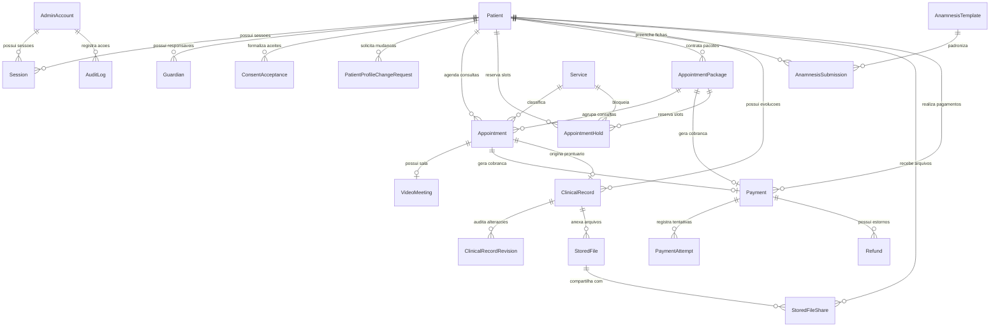
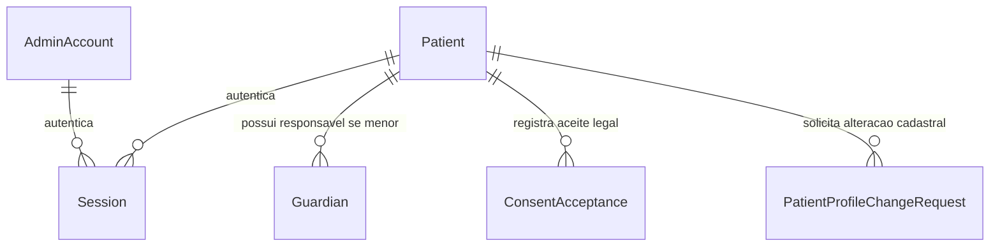
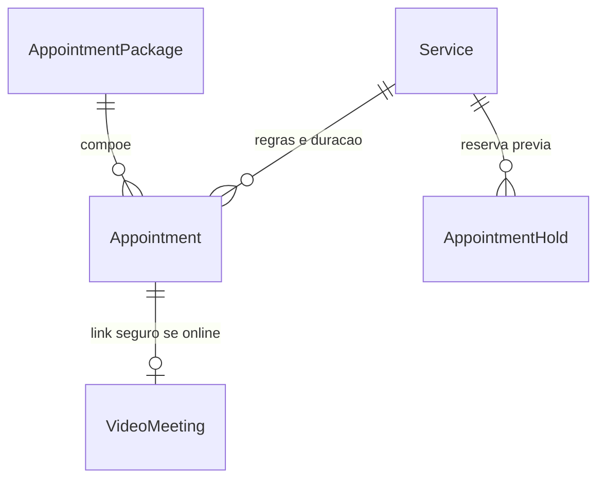
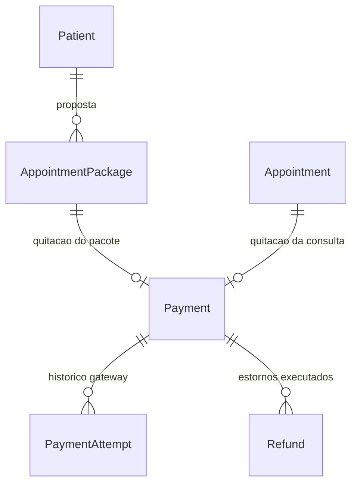
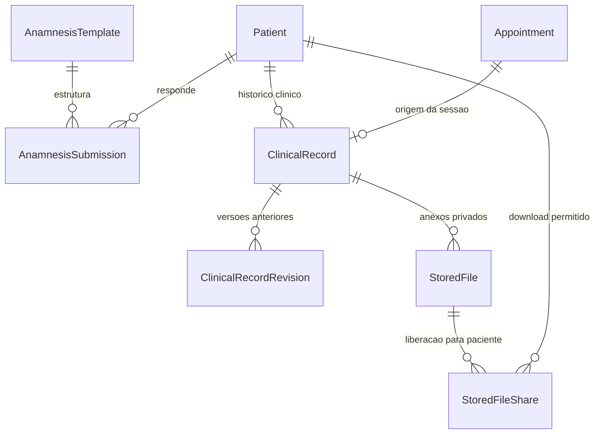
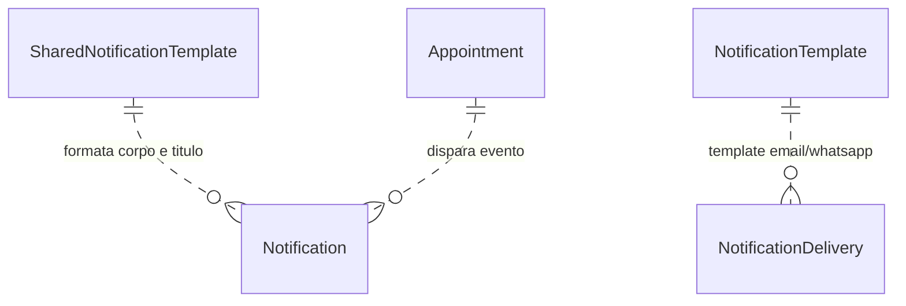
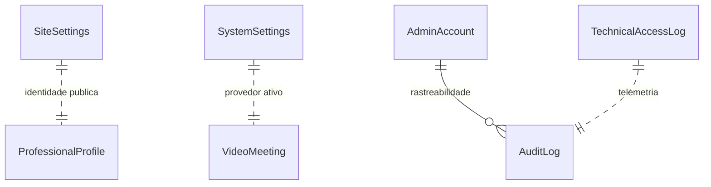

# PSI — Dicionário Completo de Dados e Modelagem do Banco (DICIONARIO_DADOS.md)

Este documento é a referência oficial e permanente sobre a estrutura relacional, regras de persistência, ciclo de vida dos dados e conexões de negócio do banco de dados do **PSI — Sistema de Gestão de Consultórios para Psicólogos e Psiquiatras**.

---

## 1. Visão Geral da Arquitetura de Dados

O PSI opera sob uma arquitetura de **instalação dedicada e autônoma (*standalone single-tenant*)**. Não existem colunas discriminadoras de inquilino (`tenantId`) nem tabelas de controle multi-empresa. Cada profissional dispõe de sua própria instância do banco MySQL/MariaDB e seu próprio diretório privado de arquivos.

### Princípios Gerais de Modelagem
1. **Separação Rígida de Papéis:** Administrador (`AdminAccount`) e Pacientes (`Patient`) possuem tabelas separadas. O acesso é unificado na tabela `Session` via token criptográfico com discriminação por `Role` (`ADMIN` ou `PATIENT`).
2. **Precisão Financeira em Centavos:** Todo e qualquer valor financeiro é estritamente armazenado como **inteiro em centavos de Real (`Int` BRL cents)**. R$ 150,00 é persistido como `15000`. Jamais são utilizados pontos flutuantes (`Float`) para dinheiro.
3. **Fuso Horário UTC e Apresentação Local:** Todos os instantes temporais (`DateTime`) são gravados em UTC puro no MySQL e formatados para o usuário final no fuso do consultório (configurado em `SystemSettings.timezone`, padrão `America/Sao_Paulo`).
4. **Sigilo Ético e Preservação Clínica:** Prontuários clínicos (`ClinicalRecord`) e suas revisões (`ClinicalRecordRevision`) **nunca são excluídos em cascata** ao desativar um paciente, garantindo conformidade com a LGPD e resoluções dos conselhos de classe (CFP/CFM).
5. **Armazenamento Híbrido de Arquivos:** Os binários físicos de uploads ficam armazenados no disco local (`storage/uploads/`), enquanto o banco armazena estritamente os metadados, controle de integridade, vínculos e permissões com expiração (`StoredFile` e `StoredFileShare`).

---

## 2. Mapa Visual de Relacionamentos (Diagramas ER Mermaid)

### 2.1 Diagrama ER Global do Sistema



---

### 2.2 Diagramas por Domínio de Negócio

#### A. Domínio: Usuários, Autenticação e Perfis


#### B. Domínio: Agenda, Serviços e Disponibilidade


#### C. Domínio: Pacotes e Transações Financeiras


#### D. Domínio: Prontuários, Anamnese e Documentos


#### E. Domínio: Notificações e Comunicação


#### F. Domínio: Configurações, Auditoria e Infraestrutura


---

## 3. Dicionário Detalhado dos Modelos e Tabelas

---

### 3.1 Modelo: `AdminAccount`

#### A. Identificação
- **Modelo Prisma:** `AdminAccount`
- **Tabela MySQL:** `AdminAccount`
- **Descrição sucinta:** Conta mestre do profissional titular do consultório (psicólogo ou psiquiatra).
- **Finalidade de negócio:** Centralizar o login administrativo, credenciais criptografadas, registro profissional (CRP/CRM) e travas de segurança contra força bruta.
- **Módulo do PSI:** Autenticação, Segurança e Painel Administrativo (`/admin`).
- **Informações sensíveis:** **Sim** (hash bcrypt da senha, e-mail privado, telefone, tentativas falhas e bloqueios).

#### B. Conteúdo Esperado
- **Registros:** Exatamente **1 registro** na instalação padrão (profissional proprietário do consultório).
- **Criação:** Durante a inicialização/instalação do sistema (`prisma/seed.js` ou assistente inicial).
- **Atualização:** Alteração de senha, mudança de dados em `/admin/configuracoes` ou incremento de `failedLogins` no login incorreto.
- **Exclusão:** Nunca é deletado durante a operação normal da clínica.
- **Exemplo fictício:**
  - `id`: `"cly78a01z000008l0h7k6a1bc"`
  - `name`: `"Dra. Helena Martins"`
  - `email`: `"adminpsi@localhost.test"`
  - `crpCrm`: `"CRP 06/123456"`

#### C. Dicionário Completo de Campos

| Campo | Tipo | Obrigatório? | Padrão | Significado | Exemplo |
| :--- | :--- | :--- | :--- | :--- | :--- |
| `id` | `String` (cuid) | Sim | `cuid()` | Identificador único e primário da conta administrativa | `"cly78a01z000008l0h7k6a1bc"` |
| `name` | `String` | Sim | Nenhum | Nome completo do profissional | `"Dra. Helena Martins"` |
| `email` | `String` | Sim | Nenhum | E-mail corporativo único utilizado para autenticação | `"adminpsi@localhost.test"` |
| `passwordHash` | `String` | Sim | Nenhum | Hash criptográfico bcrypt da senha (cost factor 10) | `"$2a$10$wKkYFm..."` |
| `phone` | `String` | Sim | Nenhum | Telefone direto do profissional com DDD | `"(11) 98765-4321"` |
| `crpCrm` | `String?` | Não | `null` | Registro no conselho profissional regional | `"CRP 06/123456"` |
| `mustChangePassword` | `Boolean` | Sim | `false` | Força a redefinição de senha no próximo login | `false` |
| `failedLogins` | `Int` | Sim | `0` | Contador consecutivo de falhas de autenticação | `0` |
| `lockedUntil` | `DateTime?` | Não | `null` | Timestamp UTC até quando a conta está bloqueada após 5 falhas | `null` |
| `createdAt` | `DateTime` | Sim | `now()` | Data e hora de criação da conta | `2026-11-04T00:00:00.000Z` |
| `updatedAt` | `DateTime` | Sim | Auto | Data e hora da última modificação | `2026-11-04T12:00:00.000Z` |

#### D. Relacionamentos
- `sessions` (`Session[]`): 1:N — Um administrador pode manter múltiplas sessões ativas (desktop, mobile). Se a conta for excluída, todas as sessões associadas são removidas em cascata (`onDelete: Cascade`).

#### E. Uso na Aplicação
- **Telas:** `/login`, `/admin/configuracoes`, `/admin/perfil`.
- **Rotas de API:** `/api/auth/login`, `/api/auth/me`, `/api/admin/profile`, `/api/auth/change-password`.
- **Serviços:** `src/lib/auth.ts`, `src/lib/current-user.ts`.

#### F. Regras de Negócio
- Após **5 tentativas incorretas** consecutivas, a conta é bloqueada por **15 minutos** através do campo `lockedUntil`.
- O login zera o contador `failedLogins` e limpa `lockedUntil`.
- Todas as tentativas (sucessos e falhas) gravam um evento em `AuditLog`.

#### G. Dependências e Impacto
- **Impacto de alteração:** Alterar o e-mail invalida JWTs antigos que esperam o e-mail anterior; exige validação em `src/lib/auth.ts` e testes em `tests/auth.test.js`.

---

### 3.2 Modelo: `Patient`

#### A. Identificação
- **Modelo Prisma:** `Patient`
- **Tabela MySQL:** `Patient`
- **Descrição sucinta:** Cadastro completo dos pacientes atendidos pelo consultório.
- **Finalidade de negócio:** Gerenciar dados civis, contato, credenciais de acesso à Área do Paciente, status de menoridade e vínculos clínicos/financeiros.
- **Módulo do PSI:** Pacientes (`/admin/pacientes`), Área do Paciente (`/paciente`).
- **Informações sensíveis:** **Sim — Elevado** (CPF, data de nascimento, endereço, contato de emergência, hash de senha).

#### B. Conteúdo Esperado
- **Registros:** Um registro para cada paciente que agendou consulta online ou foi cadastrado manualmente pelo profissional.
- **Criação:** Agendamento público inicial (`/agendamento`) ou cadastro direto em `/admin/pacientes`.
- **Atualização:** Edição de dados cadastrais, redefinição de senha ou inativação (`isActive = false`).
- **Exclusão:** Nunca é feita exclusão física para preservar histórico legal de prontuários.
- **Exemplo fictício:**
  - `fullName`: `"Mariana Souza"`
  - `email`: `"mariana.souza@email.com"`
  - `cpf`: `"123.456.789-00"`
  - `isMinor`: `false`

#### C. Dicionário Completo de Campos

| Campo | Tipo | Obrigatório? | Padrão | Significado | Exemplo |
| :--- | :--- | :--- | :--- | :--- | :--- |
| `id` | `String` (cuid) | Sim | `cuid()` | Identificador único do paciente | `"cly78a02x000108l0h8a9bc12"` |
| `fullName` | `String` | Sim | Nenhum | Nome civil completo do paciente | `"Mariana Souza"` |
| `email` | `String` | Sim | Nenhum | E-mail único utilizado para login e notificações | `"mariana.souza@email.com"` |
| `passwordHash` | `String?` | Não | `null` | Hash bcrypt da senha (nulo antes do primeiro acesso) | `"$2a$10$7s9a8b..."` |
| `tempPassword` | `String?` | Não | `null` | Senha provisória gerada no primeiro agendamento | `"Psi@9821"` |
| `mustChangePassword` | `Boolean` | Sim | `false` | Exige troca obrigatória de senha no próximo login | `true` |
| `phone` | `String` | Sim | Nenhum | Telefone celular com DDD (usado para avisos WhatsApp) | `"(11) 99123-4567"` |
| `cpf` | `String?` | Não | `null` | Cadastro de Pessoa Física (obrigatório se maior de idade) | `"123.456.789-00"` |
| `birthDate` | `DateTime?` | Não | `null` | Data de nascimento (UTC) | `1995-08-14T00:00:00.000Z` |
| `isMinor` | `Boolean` | Sim | `false` | Flag indicando se o paciente é menor de 18 anos | `false` |
| `gender` | `String?` | Não | `null` | Identidade de gênero declarada | `"Feminino"` |
| `address` | `String?` | Não | `null` | Endereço residencial completo | `"Rua das Flores, 123, São Paulo - SP"` |
| `emergencyContact` | `String?` | Não | `null` | Nome e telefone de pessoa para contato urgente | `"Carlos Souza (11) 99888-7766"` |
| `isActive` | `Boolean` | Sim | `true` | Status ativo ou inativado pelo administrador | `true` |
| `createdAt` | `DateTime` | Sim | `now()` | Data e hora do cadastro | `2026-11-04T10:00:00.000Z` |
| `updatedAt` | `DateTime` | Sim | Auto | Data e hora da última modificação | `2026-11-04T10:00:00.000Z` |

#### D. Relacionamentos
- `guardians` (`Guardian[]`): 1:N — Responsáveis legais (se `isMinor = true`). `onDelete: Cascade`.
- `consentAcceptances` (`ConsentAcceptance[]`): 1:N — Termos LGPD e consentimentos. `onDelete: Cascade`.
- `profileChanges` (`PatientProfileChangeRequest[]`): 1:N — Pedidos de alteração pendentes. `onDelete: Cascade`.
- `appointments` (`Appointment[]`): 1:N — Consultas do paciente.
- `appointmentHolds` (`AppointmentHold[]`): 1:N — Bloqueios provisórios de agenda.
- `packages` (`AppointmentPackage[]`): 1:N — Propostas de pacotes de sessões.
- `anamnesisSubmits` (`AnamnesisSubmission[]`): 1:N — Fichas de anamnese preenchidas.
- `clinicalRecords` (`ClinicalRecord[]`): 1:N — Prontuários e evoluções clínicas.
- `fileShares` (`StoredFileShare[]`): 1:N — Documentos compartilhados.
- `payments` (`Payment[]`): 1:N — Cobranças e pagamentos vinculados.
- `sessions` (`Session[]`): 1:N — Sessões de login ativas.

#### E. Uso na Aplicação
- **Telas:** `/admin/pacientes`, `/admin/pacientes/[id]`, `/paciente/perfil`, `/paciente/configuracoes`.
- **Rotas de API:** `/api/patients`, `/api/patients/[id]`, `/api/patient/me`, `/api/patient/profile`.
- **Serviços:** `src/lib/patients.ts`, `src/lib/auth.ts`.

#### F. Regras de Negócio
- Se `isMinor === true`, é **mandatório** existir ao menos 1 registro correspondente em `Guardian`.
- Alterações em campos civis críticos (`fullName`, `cpf`) feitas pelo paciente não modificam a tabela diretamente, gerando uma solicitação em `PatientProfileChangeRequest`.

#### G. Dependências e Impacto
- Tabela central do sistema: alterações em colunas impactam a agenda, faturamento, login de pacientes e prontuário.

---

### 3.3 Modelo: `Guardian`

#### A. Identificação
- **Modelo Prisma:** `Guardian`
- **Tabela MySQL:** `Guardian`
- **Descrição sucinta:** Cadastro dos responsáveis legais de pacientes menores de idade.
- **Finalidade de negócio:** Cumprimento da exigência legal e do ECA/CFP de autorização de atendimento e contato de menores.
- **Módulo do PSI:** Pacientes (`/admin/pacientes`).
- **Informações sensíveis:** **Sim** (CPF e telefone do responsável).

#### B. Conteúdo Esperado
- **Registros:** Registros criados para pacientes cujo campo `isMinor` é verdadeiro.
- **Criação:** No momento do cadastro do paciente menor de idade.
- **Exemplo fictício:**
  - `fullName`: `"Patrícia Lima"`
  - `cpf`: `"234.567.890-11"`
  - `relationship`: `"Mãe"`

#### C. Dicionário Completo de Campos

| Campo | Tipo | Obrigatório? | Padrão | Significado | Exemplo |
| :--- | :--- | :--- | :--- | :--- | :--- |
| `id` | `String` (cuid) | Sim | `cuid()` | Identificador do registro | `"cly78a03a000208l0h9b0c23"` |
| `patientId` | `String` | Sim | Nenhum | Chave estrangeira referenciando `Patient.id` | `"cly78a02x000108l0h8a9bc12"` |
| `fullName` | `String` | Sim | Nenhum | Nome completo do responsável legal | `"Patrícia Lima"` |
| `cpf` | `String` | Sim | Nenhum | CPF do responsável legal | `"234.567.890-11"` |
| `phone` | `String` | Sim | Nenhum | Telefone direto do responsável legal | `"(11) 97654-3210"` |
| `email` | `String` | Sim | Nenhum | E-mail para notificações e termos | `"patricia.lima@email.com"` |
| `relationship` | `String` | Sim | Nenhum | Grau de parentesco ou vínculo legal | `"Mãe"`, `"Pai"`, `"Tutor Legal"` |
| `createdAt` | `DateTime` | Sim | `now()` | Data de criação | `2026-11-04T10:00:00.000Z` |
| `updatedAt` | `DateTime` | Sim | Auto | Data da última alteração | `2026-11-04T10:00:00.000Z` |

#### D. Relacionamentos
- `patient` (`Patient`): N:1 via `patientId`. Se o paciente for excluído, o responsável é removido em cascata (`onDelete: Cascade`).

#### E. Uso na Aplicação
- **Telas:** `/admin/pacientes/novo`, `/admin/pacientes/[id]`.
- **Rotas de API:** `/api/patients`, `/api/patients/[id]`.

#### F. Regras de Negócio
- Não pode ser excluído se o paciente continuar marcado como `isMinor = true`.

---

### 3.4 Modelo: `PatientProfileChangeRequest`

#### A. Identificação
- **Modelo Prisma:** `PatientProfileChangeRequest`
- **Tabela MySQL:** `PatientProfileChangeRequest`
- **Descrição sucinta:** Fila de solicitações de alteração de dados cadastrais sensíveis enviadas pelo próprio paciente.
- **Finalidade de negócio:** Prevenir que pacientes alterem dados civis (nome, CPF) sem a validação e ciência do profissional.
- **Módulo do PSI:** Perfil do Paciente e Moderação Administrativa.
- **Informações sensíveis:** **Sim** (dados civis novos e antigos).

#### B. Conteúdo Esperado
- Registros criados quando um paciente tenta alterar nome civil ou CPF em seu perfil. Fica pendente até que o profissional aprove ou recuse.

#### C. Dicionário Completo de Campos

| Campo | Tipo | Obrigatório? | Padrão | Significado | Exemplo |
| :--- | :--- | :--- | :--- | :--- | :--- |
| `id` | `String` (cuid) | Sim | `cuid()` | ID primário da solicitação | `"cly78a04b000308l0h9c1d34"` |
| `patientId` | `String` | Sim | Nenhum | Chave estrangeira referenciando `Patient.id` | `"cly78a02x000108l0h8a9bc12"` |
| `field` | `String` | Sim | Nenhum | Nome do campo solicitado para alteração | `"fullName"`, `"cpf"` |
| `oldValue` | `String?` | Não | `null` | Valor anterior que consta no cadastro | `"Mariana Silva"` |
| `newValue` | `String` | Sim | Nenhum | Novo valor solicitado pelo paciente | `"Mariana Souza Silva"` |
| `status` | `String` | Sim | `"PENDING"` | Estado da solicitação: `PENDING`, `APPROVED`, `REJECTED` | `"PENDING"` |
| `reviewedAt` | `DateTime?` | Não | `null` | Data em que o profissional avaliou o pedido | `null` |
| `reviewedBy` | `String?` | Não | `null` | Identificador do usuário que realizou a revisão | `null` |
| `createdAt` | `DateTime` | Sim | `now()` | Data e hora da solicitação | `2026-11-04T11:00:00.000Z` |

#### D. Relacionamentos
- `patient` (`Patient`): N:1 via `patientId`. `onDelete: Cascade`.

#### E. Uso na Aplicação
- **Telas:** `/paciente/perfil`, `/admin/pacientes/[id]`.
- **Rotas de API:** `/api/patient/profile-requests`, `/api/admin/profile-requests/[id]`.

---

### 3.5 Modelo: `ConsentAcceptance`

#### A. Identificação
- **Modelo Prisma:** `ConsentAcceptance`
- **Tabela MySQL:** `ConsentAcceptance`
- **Descrição sucinta:** Registro de consentimento legal e aceite de políticas de privacidade (LGPD).
- **Finalidade de negócio:** Evidência probatória de que o paciente aceitou os termos e a política do consultório, gravando IP, user-agent e versão do termo.
- **Módulo do PSI:** Compliance e LGPD.
- **Informações sensíveis:** Dados de telemetria/auditoria (IP Address).

#### B. Dicionário Completo de Campos

| Campo | Tipo | Obrigatório? | Padrão | Significado | Exemplo |
| :--- | :--- | :--- | :--- | :--- | :--- |
| `id` | `String` (cuid) | Sim | `cuid()` | Identificador primário do aceite | `"cly78a05c000408l0h9d2e45"` |
| `patientId` | `String` | Sim | Nenhum | Chave estrangeira referenciando `Patient.id` | `"cly78a02x000108l0h8a9bc12"` |
| `policyType` | `String` | Sim | Nenhum | Tipo da política: `TERMS`, `PRIVACY`, `LGPD`, `TELEMEDICINE` | `"PRIVACY"` |
| `policyVersion` | `String` | Sim | Nenhum | Versão da política no momento do aceite | `"1.0"` |
| `ipAddress` | `String?` | Não | `null` | Endereço IP de onde partiu o aceite | `"189.12.34.56"` |
| `userAgent` | `String?` | Não | `null` | Navegador e sistema operacional do paciente | `"Mozilla/5.0..."` |
| `context` | `String?` | Não | `null` | Contexto do disparo (`FIRST_LOGIN`, `BOOKING`) | `"BOOKING"` |
| `acceptedAt` | `DateTime` | Sim | `now()` | Timestamp UTC exato da concordância | `2026-11-04T10:05:00.000Z` |

---

### 3.6 Modelo: `Session`

#### A. Identificação
- **Modelo Prisma:** `Session`
- **Tabela MySQL:** `Session`
- **Descrição sucinta:** Tabela de sessões de autenticação ativas (tokens de acesso).
- **Finalidade de negócio:** Controlar autenticação persistente via cookie seguro `psi_auth_token`, validando se o token não foi revogado antes de sua expiração natural.
- **Módulo do PSI:** Autenticação e Segurança.
- **Informações sensíveis:** **Sim — Crítico** (token de sessão, endereço IP).

#### B. Dicionário Completo de Campos

| Campo | Tipo | Obrigatório? | Padrão | Significado | Exemplo |
| :--- | :--- | :--- | :--- | :--- | :--- |
| `id` | `String` (cuid) | Sim | `cuid()` | ID primário do registro de sessão | `"cly78a06d000508l0h9e3f56"` |
| `token` | `String` | Sim | Nenhum | Token JWT assinado ou hash de sessão único | `"eyJhbGciOiJIUzI1NiIs..."` |
| `userId` | `String` | Sim | Nenhum | ID do usuário autenticado (seja Admin ou Paciente) | `"cly78a01z000008l0h7k6a1bc"` |
| `userRole` | `Role` (Enum) | Sim | Nenhum | Papel do usuário logado: `ADMIN` ou `PATIENT` | `ADMIN` |
| `expiresAt` | `DateTime` | Sim | Nenhum | Data e hora UTC limite de expiração da sessão | `2026-11-11T10:00:00.000Z` |
| `ipAddress` | `String?` | Não | `null` | IP da conexão no momento do login | `"127.0.0.1"` |
| `userAgent` | `String?` | Não | `null` | Informações do navegador | `"Mozilla/5.0 (Windows NT 10.0; Win64; x64)..."` |
| `createdAt` | `DateTime` | Sim | `now()` | Momento da emissão da sessão | `2026-11-04T10:00:00.000Z` |

#### C. Relacionamentos
- `adminAccount`: N:1 opcional via `userId`.
- `patient`: N:1 opcional via `userId`.
- Ambas com exclusão em cascata.

---

### 3.7 Modelo: `Service`

#### A. Identificação
- **Modelo Prisma:** `Service`
- **Tabela MySQL:** `Service`
- **Descrição sucinta:** Catálogo de serviços clínicos e tipos de consulta oferecidos.
- **Finalidade de negócio:** Definir nome, descrição, valor monetário, duração em minutos, intervalo de respiro (*buffer*), modalidade permitida e política de confirmação.
- **Módulo do PSI:** Configurações de Serviços (`/admin/servicos`) e Agendamento Público (`/agendamento`).
- **Informações sensíveis:** Não.

#### B. Dicionário Completo de Campos

| Campo | Tipo | Obrigatório? | Padrão | Significado | Exemplo |
| :--- | :--- | :--- | :--- | :--- | :--- |
| `id` | `String` (cuid) | Sim | `cuid()` | Identificador primário do serviço | `"cly78a07e000608l0h9f4g67"` |
| `name` | `String` | Sim | Nenhum | Nome comercial do atendimento | `"Psicoterapia Individual (Online)"` |
| `description` | `String?` (Text) | Não | `null` | Descrição detalhada exibida na página pública | `"Sessão individual focada em..."` |
| `priceCents` | `Int` | Sim | `0` | Preço em centavos de Real (Ex: R$ 180,00 = 18000) | `18000` |
| `isFree` | `Boolean` | Sim | `false` | Indica se o serviço é gratuito (ex: triagem inicial) | `false` |
| `durationMinutes` | `Int` | Sim | `60` | Tempo de duração da sessão clínica em minutos | `50` |
| `bufferMinutes` | `Int` | Sim | `0` | Intervalo de descanso/anotações após o atendimento | `10` |
| `modality` | `Modality` (Enum)| Sim | `BOTH` | Modalidade: `PRESENTIAL`, `ONLINE`, `BOTH` | `ONLINE` |
| `confirmationPolicy` | `ConfirmationPolicy` | Sim | `AUTOMATIC` | Regra de confirmação: `AUTOMATIC`, `UPON_PAYMENT`, `MANUAL_ADMIN`, `PAYMENT_AND_ADMIN` | `AUTOMATIC` |
| `cancellationNoticeDays` | `Int` | Sim | `3` | Dias mínimos de antecedência para cancelar sem penalidade | `3` |
| `isActive` | `Boolean` | Sim | `true` | Habilita ou desativa a exibição do serviço na agenda | `true` |
| `createdAt` | `DateTime` | Sim | `now()` | Criação do serviço | `2026-11-04T00:00:00.000Z` |
| `updatedAt` | `DateTime` | Sim | Auto | Última atualização | `2026-11-04T00:00:00.000Z` |

#### C. Relacionamentos
- `appointments` (`Appointment[]`): 1:N — Consultas agendadas com este serviço.
- `holds` (`AppointmentHold[]`): 1:N — Pré-reservas temporárias com este serviço.

---

### 3.8 Modelo: `WeeklyAvailability`

#### A. Identificação
- **Modelo Prisma:** `WeeklyAvailability`
- **Tabela MySQL:** `WeeklyAvailability`
- **Descrição sucinta:** Grade de horários padrão de atendimento semanal do consultório.
- **Finalidade de negócio:** Definir em quais dias da semana e intervalos horários o profissional atende.
- **Módulo do PSI:** Configurações de Agenda (`/admin/agenda/configuracoes`).
- **Informações sensíveis:** Não.

#### B. Dicionário Completo de Campos

| Campo | Tipo | Obrigatório? | Padrão | Significado | Exemplo |
| :--- | :--- | :--- | :--- | :--- | :--- |
| `id` | `String` (cuid) | Sim | `cuid()` | ID primário do intervalo de disponibilidade | `"cly78a08f000708l0h9g5h78"` |
| `dayOfWeek` | `Int` | Sim | Nenhum | Dia da semana: `0` = Domingo, `1` = Segunda, ..., `6` = Sábado | `1` (Segunda-feira) |
| `startTime` | `String` | Sim | Nenhum | Horário de início do turno (formato `HH:mm`) | `"08:00"` |
| `endTime` | `String` | Sim | Nenhum | Horário de término do turno (formato `HH:mm`) | `"18:00"` |
| `isActive` | `Boolean` | Sim | `true` | Ativa ou desativa temporariamente o dia | `true` |
| `createdAt` | `DateTime` | Sim | `now()` | Data de criação da regra | `2026-11-04T00:00:00.000Z` |
| `updatedAt` | `DateTime` | Sim | Auto | Data de modificação da regra | `2026-11-04T00:00:00.000Z` |

---

### 3.9 Modelo: `AvailabilityException`

#### A. Identificação
- **Modelo Prisma:** `AvailabilityException`
- **Tabela MySQL:** `AvailabilityException`
- **Descrição sucinta:** Feriados, férias, folgas ou dias de plantão com horário diferenciado.
- **Finalidade de negócio:** Sobrepor a grade semanal (`WeeklyAvailability`) para bloquear um dia inteiro, uma faixa de horas específica ou abrir um horário especial.
- **Módulo do PSI:** Agenda (`/admin/agenda`).
- **Informações sensíveis:** Não.

#### B. Dicionário Completo de Campos

| Campo | Tipo | Obrigatório? | Padrão | Significado | Exemplo |
| :--- | :--- | :--- | :--- | :--- | :--- |
| `id` | `String` (cuid) | Sim | `cuid()` | ID primário da exceção | `"cly78a09g000808l0h9h6i89"` |
| `date` | `DateTime` | Sim | Nenhum | Data da exceção (UTC à meia-noite) | `2026-12-25T00:00:00.000Z` |
| `startTime` | `String?` | Não | `null` | Início do bloqueio ou horário especial (`HH:mm`) | `"14:00"` |
| `endTime` | `String?` | Não | `null` | Fim do bloqueio ou horário especial (`HH:mm`) | `"18:00"` |
| `isBlocked` | `Boolean` | Sim | `true` | Se `true`, bloqueia agenda; se `false`, abre horário extra | `true` |
| `reason` | `String?` | Não | `null` | Motivo do bloqueio visível apenas para o profissional | `"Feriado Natalino"` |
| `createdAt` | `DateTime` | Sim | `now()` | Data de registro | `2026-11-04T00:00:00.000Z` |
| `updatedAt` | `DateTime` | Sim | Auto | Data de atualização | `2026-11-04T00:00:00.000Z` |

---

### 3.10 Modelo: `Appointment`

#### A. Identificação
- **Modelo Prisma:** `Appointment`
- **Tabela MySQL:** `Appointment`
- **Descrição sucinta:** Registro formal de uma consulta ou sessão clínica agendada.
- **Finalidade de negócio:** Representar o compromisso clínico entre profissional e paciente com horário de início e fim, status da reserva, modalidade e vínculos clínicos/financeiros.
- **Módulo do PSI:** Agenda do Profissional (`/admin/agenda`), Consultas do Paciente (`/paciente/agendamentos`).
- **Informações sensíveis:** **Sim** (associação de saúde mental, motivos de cancelamento).

#### B. Conteúdo Esperado
- Registros para cada sessão agendada individualmente ou originada de um pacote de sessões aceito.
- Exemplo fictício:
  - `startAt`: `2026-11-10T14:00:00.000Z`
  - `endAt`: `2026-11-10T14:50:00.000Z`
  - `modality`: `ONLINE`
  - `status`: `CONFIRMED`

#### C. Dicionário Completo de Campos

| Campo | Tipo | Obrigatório? | Padrão | Significado | Exemplo |
| :--- | :--- | :--- | :--- | :--- | :--- |
| `id` | `String` (cuid) | Sim | `cuid()` | ID primário da consulta | `"cly78a10h000908l0h9i7j90"` |
| `patientId` | `String` | Sim | Nenhum | Chave estrangeira referenciando `Patient.id` | `"cly78a02x000108l0h8a9bc12"` |
| `serviceId` | `String` | Sim | Nenhum | Chave estrangeira referenciando `Service.id` | `"cly78a07e000608l0h9f4g67"` |
| `packageId` | `String?` | Não | `null` | ID do pacote de sessões (se pertencer a um pacote) | `null` |
| `startAt` | `DateTime` | Sim | Nenhum | Início da consulta em UTC | `2026-11-10T14:00:00.000Z` |
| `endAt` | `DateTime` | Sim | Nenhum | Término da consulta em UTC | `2026-11-10T14:50:00.000Z` |
| `modality` | `Modality` (Enum)| Sim | Nenhum | Modalidade da consulta: `PRESENTIAL` ou `ONLINE` | `ONLINE` |
| `status` | `AppointmentStatus` | Sim | `CONFIRMED`| Status: `PENDING_CONFIRMATION`, `CONFIRMED`, `COMPLETED`, `CANCELLED`, `LATE_CANCELLED`, `NO_SHOW` | `CONFIRMED` |
| `isAdminOverride` | `Boolean` | Sim | `false` | Indica se o horário foi forçado pelo admin sobrepondo regras normais | `false` |
| `cancellationReason` | `String?` (Text)| Não | `null` | Justificativa fornecida para o cancelamento | `null` |
| `cancelledAt` | `DateTime?` | Não | `null` | Timestamp UTC do cancelamento | `null` |
| `cancelledBy` | `String?` | Não | `null` | Quem cancelou: `"PATIENT"` ou `"ADMIN"` | `null` |
| `isLateCancellation` | `Boolean` | Sim | `false` | Indica se o cancelamento violou o prazo mínimo de aviso (72h) | `false` |
| `noShowRecordedAt` | `DateTime?` | Não | `null` | Timestamp de marcação de não comparecimento do paciente | `null` |
| `noShowHandled` | `Boolean` | Sim | `false` | Indica se a falta já foi processada administrativamente | `false` |
| `meetingUrlSnapshot`| `String?` | Não | `null` | Snapshot estático da URL da sala de vídeo | `null` |
| `createdAt` | `DateTime` | Sim | `now()` | Momento da realização do agendamento | `2026-11-04T12:00:00.000Z` |
| `updatedAt` | `DateTime` | Sim | Auto | Data da última alteração de status/dados | `2026-11-04T12:00:00.000Z` |

#### D. Relacionamentos
- `patient` (`Patient`): N:1 via `patientId`.
- `service` (`Service`): N:1 via `serviceId`.
- `package` (`AppointmentPackage`): N:1 opcional via `packageId` com `onDelete: SetNull`.
- `payment` (`Payment`): 1:1 opcional via `Payment.appointmentId`.
- `clinicalRecord` (`ClinicalRecord`): 1:1 opcional via `ClinicalRecord.appointmentId`.
- `videoMeeting` (`VideoMeeting`): 1:1 opcional via `VideoMeeting.appointmentId`.

#### E. Regras de Negócio e Concorrência
- **Prevenção de Colisões:** Ao criar uma consulta, o sistema valida em transação no banco se existe colisão com outro agendamento no intervalo semiaberto `(startAt < existingEndAt AND endAt > existingStartAt)`.
- Se a modalidade for `PRESENTIAL`, o sistema **nunca** renderiza sala de teleconsulta ou link Jitsi.
- Se a modalidade for `ONLINE`, o paciente só é autorizado a entrar no link 15 minutos antes do início.

---

### 3.11 Modelo: `AppointmentHold`

#### A. Identificação
- **Modelo Prisma:** `AppointmentHold`
- **Tabela MySQL:** `AppointmentHold`
- **Descrição sucinta:** Bloqueio atômico temporário (*Draft Hold*) de horário da agenda.
- **Finalidade de negócio:** Garantir que quando um usuário está preenchendo os dados do agendamento ou quando uma proposta de pacote de sessões foi enviada, aquele slot não possa ser tomado por outro paciente.
- **Módulo do PSI:** Motor de Agendamento e Concorrência.
- **Informações sensíveis:** Não.

#### B. Dicionário Completo de Campos

| Campo | Tipo | Obrigatório? | Padrão | Significado | Exemplo |
| :--- | :--- | :--- | :--- | :--- | :--- |
| `id` | `String` (cuid) | Sim | `cuid()` | ID primário do bloqueio | `"cly78a11i001008l0h9j8k01"` |
| `holdToken` | `String` | Sim | Nenhum | Token criptográfico único entregue ao navegador do cliente | `"hold_8f9c01a2b34e56"` |
| `patientId` | `String?` | Não | `null` | Paciente que solicitou o hold (se já autenticado) | `null` |
| `serviceId` | `String` | Sim | Nenhum | Chave referenciando `Service.id` | `"cly78a07e000608l0h9f4g67"` |
| `packageId` | `String?` | Não | `null` | Chave referenciando `AppointmentPackage.id` (se hold de pacote) | `null` |
| `startAt` | `DateTime` | Sim | Nenhum | Início do slot bloqueado em UTC | `2026-11-10T14:00:00.000Z` |
| `endAt` | `DateTime` | Sim | Nenhum | Término do slot bloqueado em UTC | `2026-11-10T14:50:00.000Z` |
| `expiresAt` | `DateTime` | Sim | Nenhum | Timestamp UTC exato em que o bloqueio expira | `2026-11-04T12:15:00.000Z` |
| `ownerSession`| `String?` | Não | `null` | Identificador de sessão anônima do navegador | `"sess_anon_91238"` |
| `reason` | `String?` | Não | `null` | Motivo do bloqueio: `"BOOKING_DRAFT"`, `"PACKAGE_PROPOSAL"` | `"BOOKING_DRAFT"` |
| `createdAt` | `DateTime` | Sim | `now()` | Criação do bloqueio | `2026-11-04T12:00:00.000Z` |

#### C. Regras de Negócio
- Holds de agendamento online expiram em **15 minutos**. Se expirado, consultas subsequentes consideram o horário livre.

---

### 3.12 Modelo: `AppointmentPackage`

#### A. Identificação
- **Modelo Prisma:** `AppointmentPackage`
- **Tabela MySQL:** `AppointmentPackage`
- **Descrição sucinta:** Pacotes fechados de consultas propostos pelo profissional para o paciente.
- **Finalidade de negócio:** Permitir a contratação de blocos de sessões (ex: pacote mensal de 4 consultas) com desconto e aceite atômico pelo paciente.
- **Módulo do PSI:** Pacotes do Profissional (`/admin/pacotes`) e Área do Paciente (`/paciente/pacotes`).
- **Informações sensíveis:** Valores e dados de contratação.

#### B. Dicionário Completo de Campos

| Campo | Tipo | Obrigatório? | Padrão | Significado | Exemplo |
| :--- | :--- | :--- | :--- | :--- | :--- |
| `id` | `String` (cuid) | Sim | `cuid()` | ID primário do pacote | `"cly78a12j001108l0h9k9l12"` |
| `patientId` | `String` | Sim | Nenhum | Chave referenciando `Patient.id` | `"cly78a02x000108l0h8a9bc12"` |
| `title` | `String` | Sim | Nenhum | Nome comercial do pacote | `"Pacote Mensal - 4 Sessões de Psicoterapia"` |
| `description` | `String?` (Text) | Não | `null` | Detalhamento dos termos e frequência | `"Sessões semanais às terças-feiras"` |
| `totalPriceCents` | `Int` | Sim | `0` | Valor total com desconto em centavos de Real | `64000` (R$ 640,00) |
| `status` | `PackageAcceptanceStatus`| Sim | `PROPOSED` | `PROPOSED`, `ACCEPTED`, `REJECTED`, `EXPIRED` | `PROPOSED` |
| `expiresAt` | `DateTime?` | Não | `null` | Prazo limite para o paciente aceitar a proposta | `2026-11-07T23:59:59.000Z` |
| `acceptedAt` | `DateTime?` | Não | `null` | Timestamp UTC do aceite pelo paciente | `null` |
| `rejectedAt` | `DateTime?` | Não | `null` | Timestamp UTC de eventual recusa | `null` |
| `createdAt` | `DateTime` | Sim | `now()` | Criação do pacote | `2026-11-04T12:00:00.000Z` |
| `updatedAt` | `DateTime` | Sim | Auto | Última atualização | `2026-11-04T12:00:00.000Z` |

#### C. Regras de Negócio (Princípio "Tudo ou Nada")
- Ao aceitar o pacote, todos os horários vinculados passam simultaneamente para `CONFIRMED`.
- Se o pacote for rejeitado ou expirar, todos os holds vinculados são imediatamente liberados na agenda.

---

### 3.13 Modelo: `Payment`

#### A. Identificação
- **Modelo Prisma:** `Payment`
- **Tabela MySQL:** `Payment`
- **Descrição sucinta:** Registro financeiro de cobrança de consulta avulsa ou pacote de sessões.
- **Finalidade de negócio:** Controlar status financeiro (`PENDING`, `APPROVED`, `REFUNDED`), método de quitação, valores em centavos e chave de idempotência.
- **Módulo do PSI:** Financeiro (`/admin/financeiro`).
- **Informações sensíveis:** **Sim** (dados de valores e transações financeiras).

#### B. Dicionário Completo de Campos

| Campo | Tipo | Obrigatório? | Padrão | Significado | Exemplo |
| :--- | :--- | :--- | :--- | :--- | :--- |
| `id` | `String` (cuid) | Sim | `cuid()` | ID primário da cobrança | `"cly78a13k001208l0h9l0m23"` |
| `appointmentId` | `String?` | Não | `null` | Consulta vinculada (se cobrança avulsa). Campo `@unique` | `"cly78a10h000908l0h9i7j90"` |
| `packageId` | `String?` | Não | `null` | Pacote vinculado (se cobrança de pacote). Campo `@unique` | `null` |
| `patientId` | `String` | Sim | Nenhum | Chave referenciando `Patient.id` | `"cly78a02x000108l0h8a9bc12"` |
| `amountCents` | `Int` | Sim | Nenhum | Valor total em centavos inteiros de Real | `18000` |
| `status` | `PaymentStatus` | Sim | `PENDING` | `PENDING`, `APPROVED`, `REJECTED`, `CANCELLED`, `REFUNDED` | `PENDING` |
| `method` | `PaymentMethod` | Sim | `ONLINE_SIMULATED`| Método: `ONLINE_SIMULATED`, `IN_PERSON`, `WHATSAPP_ARRANGED` | `ONLINE_SIMULATED` |
| `isSimulated` | `Boolean` | Sim | `true` | Indica se o pagamento ocorreu via simulador interno ou gateway real | `true` |
| `externalReference` | `String?` | Não | `null` | ID da transação no gateway externo ou código PIX | `"pix_tx_98120348"` |
| `idempotencyKey` | `String?` | Não | `null` | Chave única anti-duplicação de cobrança | `"idem_98ab76cd54"` |
| `confirmedAt` | `DateTime?` | Não | `null` | Data e hora UTC da aprovação do pagamento | `null` |
| `confirmedBy` | `String?` | Não | `null` | Quem confirmou: `"SYSTEM"` ou ID do Admin | `null` |
| `createdAt` | `DateTime` | Sim | `now()` | Data de lançamento | `2026-11-04T12:00:00.000Z` |
| `updatedAt` | `DateTime` | Sim | Auto | Data de modificação | `2026-11-04T12:00:00.000Z` |

#### C. Relacionamentos
- `appointment` (`Appointment`): 1:1 opcional via `appointmentId`.
- `package` (`AppointmentPackage`): 1:1 opcional via `packageId`.
- `patient` (`Patient`): N:1 via `patientId`.
- `attempts` (`PaymentAttempt[]`): 1:N — Histórico de tentativas de cobrança vinculadas.
- `refunds` (`Refund[]`): 1:N — Histórico de estornos associados ao pagamento.

---

### 3.14 Modelo: `PaymentAttempt`

#### A. Identificação
- **Modelo Prisma:** `PaymentAttempt`
- **Tabela MySQL:** `PaymentAttempt`
- **Descrição sucinta:** Histórico técnico de tentativas de processamento de um pagamento.
- **Finalidade de negócio:** Rastrear falhas de cartão, retornos de webhook e transações recusadas para auditoria e suporte.
- **Módulo do PSI:** Financeiro e Logs Técnicos.

#### B. Dicionário Completo de Campos

| Campo | Tipo | Obrigatório? | Padrão | Significado | Exemplo |
| :--- | :--- | :--- | :--- | :--- | :--- |
| `id` | `String` (cuid) | Sim | `cuid()` | ID primário da tentativa | `"cly78a14l001308l0h9m1n34"` |
| `paymentId` | `String` | Sim | Nenhum | Chave referenciando `Payment.id` | `"cly78a13k001208l0h9l0m23"` |
| `amountCents` | `Int` | Sim | Nenhum | Valor submetido na tentativa em centavos | `18000` |
| `rawStatus` | `String` | Sim | Nenhum | Status bruto retornado pelo gateway | `"authorized"` ou `"declined"` |
| `rawResponse`| `String?` (Text) | Não | `null` | JSON completo de resposta do provedor de pagamento | `"{\"code\":\"00\",\"status\":\"paid\"}"` |
| `createdAt` | `DateTime` | Sim | `now()` | Timestamp UTC do disparo da tentativa | `2026-11-04T12:01:00.000Z` |

---

### 3.15 Modelo: `Refund`

#### A. Identificação
- **Modelo Prisma:** `Refund`
- **Tabela MySQL:** `Refund`
- **Descrição sucinta:** Registro de estornos e devoluções financeiras.
- **Finalidade de negócio:** Comprovar restituição de valores ao paciente com motivo e responsável registrado.
- **Módulo do PSI:** Financeiro.

#### B. Dicionário Completo de Campos

| Campo | Tipo | Obrigatório? | Padrão | Significado | Exemplo |
| :--- | :--- | :--- | :--- | :--- | :--- |
| `id` | `String` (cuid) | Sim | `cuid()` | ID primário do estorno | `"cly78a15m001408l0h9n2o45"` |
| `paymentId` | `String` | Sim | Nenhum | Chave referenciando `Payment.id` | `"cly78a13k001208l0h9l0m23"` |
| `amountCents` | `Int` | Sim | Nenhum | Quantia estornada em centavos de Real | `18000` |
| `reason` | `String?` | Não | `null` | Justificativa do estorno | `"Consulta cancelada com mais de 72h de antecedência"` |
| `refundedAt` | `DateTime` | Sim | `now()` | Timestamp UTC da operação de estorno | `2026-11-04T12:05:00.000Z` |
| `refundedBy` | `String` | Sim | Nenhum | Identificador do Admin que autorizou o estorno | `"cly78a01z000008l0h7k6a1bc"` |

---

### 3.16 Modelo: `GatewayConfiguration`

#### A. Identificação
- **Modelo Prisma:** `GatewayConfiguration`
- **Tabela MySQL:** `GatewayConfiguration`
- **Descrição sucinta:** Slots de configuração para integração com gateways de pagamento futuros (ex: Asaas, Mercado Pago, Pagar.me).
- **Finalidade de negócio:** Guardar credenciais de API criptografadas e chave do provedor.
- **Módulo do PSI:** Configurações Financeiras e Integrações.
- **Informações sensíveis:** **Sim — Crítico** (`configDataEncrypted` contém tokens de API).

#### B. Dicionário Completo de Campos

| Campo | Tipo | Obrigatório? | Padrão | Significado | Exemplo |
| :--- | :--- | :--- | :--- | :--- | :--- |
| `id` | `String` (cuid) | Sim | `cuid()` | ID primário da configuração | `"cly78a16n001508l0h9o3p56"` |
| `slotNumber` | `Int` | Sim | Nenhum | Número ordinal do slot (campo `@unique`) | `1` |
| `providerKey` | `String` | Sim | Nenhum | Identificador do provedor: `"ASAAS"`, `"MERCADOPAGO"` | `"MERCADOPAGO"` |
| `name` | `String` | Sim | Nenhum | Nome amigável do gateway | `"Mercado Pago Produção"` |
| `isEnabled` | `Boolean` | Sim | `false` | Se a integração está ativa para processar cobranças | `false` |
| `configDataEncrypted`| `String?` (Text) | Não | `null` | Payload JSON criptografado com segredos de API | `"aes-256-gcm:..."` |
| `updatedAt` | `DateTime` | Sim | Auto | Data da última alteração de credenciais | `2026-11-04T12:00:00.000Z` |

---

### 3.17 Modelo: `AnamnesisTemplate`

#### A. Identificação
- **Modelo Prisma:** `AnamnesisTemplate`
- **Tabela MySQL:** `AnamnesisTemplate`
- **Descrição sucinta:** Modelo ou questionário estruturado de anamnese configurado pelo profissional.
- **Finalidade de negócio:** Permitir que o profissional crie perguntas, seções e tipos de resposta (texto, múltipla escolha) para serem respondidas pelo paciente.
- **Módulo do PSI:** Anamnese (`/admin/anamnese`).
- **Informações sensíveis:** Não (contém a estrutura das perguntas, não as respostas do paciente).

#### B. Dicionário Completo de Campos

| Campo | Tipo | Obrigatório? | Padrão | Significado | Exemplo |
| :--- | :--- | :--- | :--- | :--- | :--- |
| `id` | `String` (cuid) | Sim | `cuid()` | ID primário do questionário | `"cly78a17o001608l0h9p4q67"` |
| `title` | `String` | Sim | Nenhum | Título do formulário | `"Ficha de Anamnese Adulto V1"` |
| `description` | `String?` (Text) | Não | `null` | Instruções exibidas no topo do formulário | `"Por favor, responda com sinceridade..."` |
| `version` | `Int` | Sim | `1` | Versão numérica do formulário | `1` |
| `fieldsJson` | `String` (Text) | Sim | Nenhum | Estrutura de perguntas e tipos serializada em JSON | `"[{\"id\":\"q1\",\"label\":\"Motivo da consulta\",\"type\":\"text\"}]"` |
| `isActive` | `Boolean` | Sim | `true` | Se está disponível para novos preenchimentos | `true` |
| `createdAt` | `DateTime` | Sim | `now()` | Data de criação | `2026-11-04T00:00:00.000Z` |
| `updatedAt` | `DateTime` | Sim | Auto | Data de atualização | `2026-11-04T00:00:00.000Z` |

#### C. Relacionamentos
- `submissions` (`AnamnesisSubmission[]`): 1:N — Fichas de respostas enviadas pelos pacientes com base neste questionário.

---

### 3.18 Modelo: `AnamnesisSubmission`

#### A. Identificação
- **Modelo Prisma:** `AnamnesisSubmission`
- **Tabela MySQL:** `AnamnesisSubmission`
- **Descrição sucinta:** Respostas enviadas pelo paciente para a ficha de anamnese.
- **Finalidade de negócio:** Coletar histórico de saúde física, emocional, queixas principais e medicações para consulta do profissional.
- **Módulo do PSI:** Anamnese do Paciente (`/paciente/anamnese`) e Revisão Clínica (`/admin/anamnese/respostas`).
- **Informações sensíveis:** **Sim — Altamente Confidencial** (dados íntimos de saúde).

#### B. Dicionário Completo de Campos

| Campo | Tipo | Obrigatório? | Padrão | Significado | Exemplo |
| :--- | :--- | :--- | :--- | :--- | :--- |
| `id` | `String` (cuid) | Sim | `cuid()` | ID primário da submissão | `"cly78a18p001708l0h9q5r78"` |
| `templateId` | `String` | Sim | Nenhum | Chave referenciando `AnamnesisTemplate.id` | `"cly78a17o001608l0h9p4q67"` |
| `patientId` | `String` | Sim | Nenhum | Chave referenciando `Patient.id` | `"cly78a02x000108l0h8a9bc12"` |
| `templateVersion` | `Int` | Sim | Nenhum | Versão do questionário no momento da resposta | `1` |
| `answersJson` | `String` (Text) | Sim | Nenhum | Respostas do paciente serializadas em JSON | `"{\"q1\":\"Dificuldade para dormir e ansiedade constante\"}"` |
| `status` | `AnamnesisSubmissionStatus` | Sim | `PENDING_REVIEW` | `PENDING_REVIEW`, `APPROVED`, `REVISION_REQUESTED` | `APPROVED` |
| `reviewedAt` | `DateTime?` | Não | `null` | Data e hora UTC da validação pelo profissional | `2026-11-04T13:00:00.000Z` |
| `reviewerNotes` | `String?` (Text) | Não | `null` | Anotações internas do profissional sobre as respostas | `"Paciente apresenta quadro ansiogênico moderado"` |
| `createdAt` | `DateTime` | Sim | `now()` | Momento do envio da anamnese pelo paciente | `2026-11-04T12:30:00.000Z` |
| `updatedAt` | `DateTime` | Sim | Auto | Data da última revisão/alteração de status | `2026-11-04T13:00:00.000Z` |

#### C. Relacionamentos
- `template` (`AnamnesisTemplate`): N:1 via `templateId`.
- `patient` (`Patient`): N:1 via `patientId`.

#### D. Regras de Negócio
- Após a submissão bem-sucedida, o paciente **não pode** reenviar nem editar a ficha. O backend bloqueia tentativas duplicadas com código `409 Conflict`.
- Na interface do paciente, a ficha desaparece e é substituída por um cartão de confirmação de conclusão.

---

### 3.19 Modelo: `ClinicalRecord`

#### A. Identificação
- **Modelo Prisma:** `ClinicalRecord`
- **Tabela MySQL:** `ClinicalRecord`
- **Descrição sucinta:** Prontuário eletrônico do paciente e evolução clínica de cada sessão.
- **Finalidade de negócio:** Manter registro ético e legal do atendimento, evolução psicológica/psiquiátrica, humor do paciente e plano terapêutico.
- **Módulo do PSI:** Prontuário Clínico (`/admin/prontuarios`).
- **Informações sensíveis:** **Sim — Sigilo Médico/Psicológico Absoluto** (acessível **exclusivamente** pelo ADMIN).

#### B. Dicionário Completo de Campos

| Campo | Tipo | Obrigatório? | Padrão | Significado | Exemplo |
| :--- | :--- | :--- | :--- | :--- | :--- |
| `id` | `String` (cuid) | Sim | `cuid()` | ID primário do registro de prontuário | `"cly78a19q001808l0h9r6s89"` |
| `appointmentId` | `String?` | Não | `null` | Consulta vinculada (campo `@unique`). Pode ser nulo se nota avulsa | `"cly78a10h000908l0h9i7j90"` |
| `patientId` | `String` | Sim | Nenhum | Chave referenciando `Patient.id` | `"cly78a02x000108l0h8a9bc12"` |
| `sessionDate` | `DateTime` | Sim | Nenhum | Data e hora em que a sessão de fato ocorreu | `2026-11-10T14:00:00.000Z` |
| `noteRichText` | `String` (MediumText)| Sim | Nenhum | Anotação clínica de evolução em formato rico/HTML | `"<p>Paciente relatou melhora nos episódios...</p>"` |
| `summary` | `String?` (Text) | Não | `null` | Resumo executivo da sessão em uma ou duas frases | `"Evolução positiva; trabalhado manejo de crise."` |
| `moodRating` | `Int?` | Não | `null` | Escala clínica de humor observada (ex: de 1 a 10) | `7` |
| `createdAt` | `DateTime` | Sim | `now()` | Criação do prontuário | `2026-11-10T15:00:00.000Z` |
| `updatedAt` | `DateTime` | Sim | Auto | Última modificação | `2026-11-10T15:00:00.000Z` |

#### C. Relacionamentos
- `appointment`: 1:1 opcional via `appointmentId` com `onDelete: SetNull`.
- `patient`: N:1 via `patientId` com `onDelete: Cascade`.
- `revisions` (`ClinicalRecordRevision[]`): 1:N — Versões anteriores arquivadas.
- `attachments` (`StoredFile[]`): 1:N — Arquivos vinculados à evolução.

#### D. Regras de Negócio e Segurança
- **Sigilo Absoluto:** Nenhuma rota sob o prefixo `/api/patient/*` ou `/paciente/*` possui autorização para ler dados de `ClinicalRecord`.
- Toda alteração em `noteRichText` gera uma cópia histórica em `ClinicalRecordRevision`.

---

### 3.20 Modelo: `ClinicalRecordRevision`

#### A. Identificação
- **Modelo Prisma:** `ClinicalRecordRevision`
- **Tabela MySQL:** `ClinicalRecordRevision`
- **Descrição sucinta:** Trilha de auditoria e versionamento de edições no prontuário clínico.
- **Finalidade de negócio:** Garantir inviolabilidade e rastreabilidade jurídica do prontuário conforme normas dos conselhos profissionais, preservando o que foi escrito antes de cada edição.
- **Módulo do PSI:** Prontuário e Auditoria Clínica.
- **Informações sensíveis:** **Sim — Altamente Confidencial**.

#### B. Dicionário Completo de Campos

| Campo | Tipo | Obrigatório? | Padrão | Significado | Exemplo |
| :--- | :--- | :--- | :--- | :--- | :--- |
| `id` | `String` (cuid) | Sim | `cuid()` | ID primário da revisão | `"cly78a20r001908l0h9s7t90"` |
| `recordId` | `String` | Sim | Nenhum | Chave referenciando `ClinicalRecord.id` | `"cly78a19q001808l0h9r6s89"` |
| `contentSnapshot` | `String` (MediumText)| Sim | Nenhum | Conteúdo textual exato antes da alteração | `"<p>Texto original antes da revisão...</p>"` |
| `moodRatingSnapshot`| `Int?` | Não | `null` | Nota de humor antes da revisão | `6` |
| `revisedAt` | `DateTime` | Sim | `now()` | Timestamp UTC exato da edição | `2026-11-10T16:00:00.000Z` |
| `revisedBy` | `String` | Sim | Nenhum | Identificador do usuário que realizou a alteração | `"cly78a01z000008l0h7k6a1bc"` |

#### C. Relacionamentos
- `record` (`ClinicalRecord`): N:1 via `recordId` com exclusão em cascata (`onDelete: Cascade`).

---

### 3.21 Modelo: `StoredFile`

#### A. Identificação
- **Modelo Prisma:** `StoredFile`
- **Tabela MySQL:** `StoredFile`
- **Descrição sucinta:** Registro de metadados de arquivos binários armazenados privadamente no disco.
- **Finalidade de negócio:** Catalogar arquivos anexados a prontuários, documentos enviados por pacientes ou backups do sistema, mantendo os arquivos físicos em diretório não público (`storage/uploads/`).
- **Módulo do PSI:** Gestão de Documentos (`/admin/documentos`) e Prontuários.
- **Informações sensíveis:** **Sim** (associação a laudos, exames ou atestados).

#### B. Dicionário Completo de Campos

| Campo | Tipo | Obrigatório? | Padrão | Significado | Exemplo |
| :--- | :--- | :--- | :--- | :--- | :--- |
| `id` | `String` (cuid) | Sim | `cuid()` | ID primário do documento | `"cly78a21s002008l0h9t8u01"` |
| `title` | `String?` | Não | `null` | Título legível ou nome de exibição do documento | `"Atestado de Aptidão Física"` |
| `description` | `String?` (Text) | Não | `null` | Observações ou orientações sobre o arquivo | `"Documento emitido para apresentação no trabalho."` |
| `originalName` | `String` | Sim | Nenhum | Nome original do arquivo enviado pelo usuário | `"Laudo_Neuropsicologico.pdf"` |
| `storedFileName` | `String` | Sim | Nenhum | Nome criptografado/hasheado gravado no disco físico (`@unique`) | `"file_a1b2c3d4e5f6g7h8.pdf"` |
| `mimeType` | `String` | Sim | Nenhum | Tipo MIME validado do arquivo | `"application/pdf"`, `"image/jpeg"` |
| `sizeBytes` | `Int` | Sim | Nenhum | Tamanho exato do arquivo em bytes | `1048576` (1 MB) |
| `category` | `String` | Sim | Nenhum | Categoria: `"CLINICAL_NOTE_EXPORT"`, `"PATIENT_DOCUMENT"`, `"SYSTEM_BACKUP"` | `"PATIENT_DOCUMENT"` |
| `clinicalRecordId` | `String?` | Não | `null` | Chave referenciando `ClinicalRecord.id` (se anexo de prontuário) | `null` |
| `uploadedBy` | `String` | Sim | Nenhum | ID do usuário que fez o upload | `"cly78a01z000008l0h7k6a1bc"` |
| `createdAt` | `DateTime` | Sim | `now()` | Data e hora do upload | `2026-11-04T12:00:00.000Z` |

#### C. Relacionamentos
- `clinicalRecord` (`ClinicalRecord`): N:1 opcional via `clinicalRecordId`.
- `shares` (`StoredFileShare[]`): 1:N — Permissões de compartilhamento emitidas para este arquivo.

---

### 3.22 Modelo: `StoredFileShare`

#### A. Identificação
- **Modelo Prisma:** `StoredFileShare`
- **Tabela MySQL:** `StoredFileShare`
- **Descrição sucinta:** Permissão de acesso controlado concedida a um paciente para baixar um arquivo específico.
- **Finalidade de negócio:** Viabilizar que o profissional compartilhe atestados, receitas, recibos ou relatórios com o paciente de forma segura e com prazo de expiração.
- **Módulo do PSI:** Documentos do Paciente (`/paciente/documentos`).
- **Informações sensíveis:** **Sim**.

#### B. Dicionário Completo de Campos

| Campo | Tipo | Obrigatório? | Padrão | Significado | Exemplo |
| :--- | :--- | :--- | :--- | :--- | :--- |
| `id` | `String` (cuid) | Sim | `cuid()` | ID primário da autorização de compartilhamento | `"cly78a22t002108l0h9u9v12"` |
| `fileId` | `String` | Sim | Nenhum | Chave referenciando `StoredFile.id` | `"cly78a21s002008l0h9t8u01"` |
| `patientId` | `String` | Sim | Nenhum | Chave referenciando `Patient.id` | `"cly78a02x000108l0h8a9bc12"` |
| `canDownload` | `Boolean` | Sim | `true` | Autoriza download do arquivo | `true` |
| `expiresAt` | `DateTime?` | Não | `null` | Data e hora limite para download (se nulo, acesso permanente) | `2026-12-31T23:59:59.000Z` |
| `revokedAt` | `DateTime?` | Não | `null` | Data e hora em que o acesso foi explicitamente revogado pelo profissional | `2026-11-05T10:00:00.000Z` |
| `sharedAt` | `DateTime` | Sim | `now()` | Data e hora em que o compartilhamento foi realizado | `2026-11-04T12:00:00.000Z` |

#### C. Relacionamentos
- `file` (`StoredFile`): N:1 via `fileId` com remoção em cascata (`onDelete: Cascade`).
- `patient` (`Patient`): N:1 via `patientId` com remoção em cascata (`onDelete: Cascade`).

---

### 3.23 Modelo: `VideoMeeting`

#### A. Identificação
- **Modelo Prisma:** `VideoMeeting`
- **Tabela MySQL:** `VideoMeeting`
- **Descrição sucinta:** Informações técnicas e tokens de acesso para a sala de teleconsulta.
- **Finalidade de negócio:** Gerenciar a criação de salas virtuais isoladas por sessão online, nome da sala único e token temporário de entrada.
- **Módulo do PSI:** Teleconsulta e Vídeo (`/sala-virtual`).
- **Informações sensíveis:** **Sim** (tokens de sala).

#### B. Dicionário Completo de Campos

| Campo | Tipo | Obrigatório? | Padrão | Significado | Exemplo |
| :--- | :--- | :--- | :--- | :--- | :--- |
| `id` | `String` (cuid) | Sim | `cuid()` | ID primário da sala virtual | `"cly78a23u002208l0h9v0w23"` |
| `appointmentId` | `String` | Sim | Nenhum | Chave referenciando `Appointment.id` (campo `@unique`) | `"cly78a10h000908l0h9i7j90"` |
| `provider` | `String` | Sim | `"JITSI"` | Provedor de vídeo utilizado: `"JITSI"`, `"PEERJS"`, `"GOOGLE_MEET"` | `"JITSI"` |
| `roomName` | `String` | Sim | Nenhum | Nome único pseudoaleatório da sala (`@unique`) | `"psi_sala_98a7bc6d5e4f"` |
| `psiEntryToken` | `String` | Sim | Nenhum | Token interno de autorização de entrada (`@unique`) | `"tok_meet_18273645"` |
| `createdAt` | `DateTime` | Sim | `now()` | Momento em que a sala foi gerada | `2026-11-04T12:00:00.000Z` |

---

### 3.24 Modelo: `NotificationTemplate`

#### A. Identificação
- **Modelo Prisma:** `NotificationTemplate`
- **Tabela MySQL:** `NotificationTemplate`
- **Descrição sucinta:** Modelos de e-mail e mensagens de WhatsApp externos legados.
- **Finalidade de negócio:** Estruturar o assunto e o corpo das mensagens automáticas de confirmação, cancelamento e lembretes externos por canal (`EMAIL` ou `WHATSAPP`).
- **Módulo do PSI:** Comunicação e Mensageria Externa.

#### B. Dicionário Completo de Campos

| Campo | Tipo | Obrigatório? | Padrão | Significado | Exemplo |
| :--- | :--- | :--- | :--- | :--- | :--- |
| `id` | `String` (cuid) | Sim | `cuid()` | ID primário do modelo | `"cly78a24v002308l0h9w1x34"` |
| `type` | `NotificationType` (Enum)| Sim | Nenhum | Tipo do evento disparador | `APPOINTMENT_CONFIRMED` |
| `channel` | `NotificationChannel` (Enum)| Sim | Nenhum | Canal de disparo: `EMAIL` ou `WHATSAPP` | `EMAIL` |
| `subject` | `String?` | Não | `null` | Linha de assunto do e-mail | `"Confirmação de Consulta - Dra. Helena"` |
| `bodyTemplate` | `String` (Text) | Sim | Nenhum | Corpo do texto com placeholders como `{nome_paciente}` | `"Olá {nome_paciente}, sua consulta foi..."` |
| `isActive` | `Boolean` | Sim | `true` | Ativação do template | `true` |
| `updatedAt` | `DateTime` | Sim | Auto | Data de modificação | `2026-11-04T12:00:00.000Z` |

---

### 3.25 Modelo: `NotificationDelivery`

#### A. Identificação
- **Modelo Prisma:** `NotificationDelivery`
- **Tabela MySQL:** `NotificationDelivery`
- **Descrição sucinta:** Histórico e status de entrega de disparos para canais externos (SMTP e WhatsApp).
- **Finalidade de negócio:** Rastrear mensagens enviadas, prevenir reenvios duplicados através de `idempotencyKey` e registrar se o disparo foi real ou simulado.
- **Módulo do PSI:** Mensageria Externa.

#### B. Dicionário Completo de Campos

| Campo | Tipo | Obrigatório? | Padrão | Significado | Exemplo |
| :--- | :--- | :--- | :--- | :--- | :--- |
| `id` | `String` (cuid) | Sim | `cuid()` | ID primário do registro de disparo | `"cly78a25w002408l0h9x2y45"` |
| `recipient` | `String` | Sim | Nenhum | Destinatário (e-mail ou número de telefone) | `"mariana.souza@email.com"` |
| `channel` | `NotificationChannel` | Sim | Nenhum | Canal utilizado: `EMAIL` ou `WHATSAPP` | `EMAIL` |
| `templateType`| `NotificationType` | Sim | Nenhum | Tipo do evento disparado | `REMINDER_24H` |
| `status` | `String` | Sim | Nenhum | Status: `"DELIVERED"`, `"SIMULATED"`, `"FAILED"` | `"SIMULATED"` |
| `simulated` | `Boolean` | Sim | `true` | Flag indicando se o disparo usou o simulador interno | `true` |
| `errorDetails` | `String?` | Não | `null` | Detalhes do erro caso status seja `FAILED` | `null` |
| `idempotencyKey`| `String?` | Não | `null` | Chave única anti-duplicação (`@unique`) | `"notif_rem_24h_cly78a10"` |
| `sentAt` | `DateTime` | Sim | `now()` | Timestamp UTC do disparo | `2026-11-04T12:00:00.000Z` |

---

### 3.26 Modelo: `Notification`

#### A. Identificação
- **Modelo Prisma:** `Notification`
- **Tabela MySQL:** `Notification`
- **Descrição sucinta:** Notificações internas persistentes no aplicativo para o Admin e para os Pacientes.
- **Finalidade de negócio:** Alimentar o sino no cabeçalho (*NotificationBell*), contador de não lidas e telas de histórico de notificações (`/admin/notificacoes` e `/paciente/notificacoes`).
- **Módulo do PSI:** Central de Notificações Internas.
- **Informações sensíveis:** Não (mensagens operacionais e administrativas).

#### B. Dicionário Completo de Campos

| Campo | Tipo | Obrigatório? | Padrão | Significado | Exemplo |
| :--- | :--- | :--- | :--- | :--- | :--- |
| `id` | `String` (cuid) | Sim | `cuid()` | ID primário da notificação | `"cly78a26x002508l0h9y3z56"` |
| `recipientId` | `String` | Sim | Nenhum | ID do usuário destinatário (`Patient.id` ou `AdminAccount.id`) | `"cly78a01z000008l0h7k6a1bc"` |
| `recipientRole`| `String` | Sim | Nenhum | Papel do destinatário: `"ADMIN"` ou `"PATIENT"` | `"ADMIN"` |
| `eventType` | `String` | Sim | Nenhum | Tipo do evento: `"APPOINTMENT_CREATED"`, `"PAYMENT_RECEIVED"`, etc. | `"APPOINTMENT_CREATED"` |
| `title` | `String` | Sim | Nenhum | Título sucinto da notificação | `"Nova consulta agendada"` |
| `message` | `String` (Text) | Sim | Nenhum | Mensagem completa explicativa | `"Mariana Souza agendou Psicoterapia para 10/11 às 14:00."` |
| `targetUrl` | `String?` | Não | `null` | Rota interna para onde o usuário é direcionado ao clicar | `"/admin/agenda"` |
| `isRead` | `Boolean` | Sim | `false` | Indica se a notificação já foi visualizada/lida | `false` |
| `readAt` | `DateTime?` | Não | `null` | Timestamp UTC em que a notificação foi marcada como lida | `null` |
| `relatedEntityType` | `String?` | Não | `null` | Entidade vinculada: `"Appointment"`, `"Payment"`, `"Package"` | `"Appointment"` |
| `relatedEntityId` | `String?` | Não | `null` | Identificador da entidade vinculada | `"cly78a10h000908l0h9i7j90"` |
| `createdAt` | `DateTime` | Sim | `now()` | Timestamp UTC do recebimento | `2026-11-04T12:00:00.000Z` |

---

### 3.27 Modelo: `SharedNotificationTemplate`

#### A. Identificação
- **Modelo Prisma:** `SharedNotificationTemplate`
- **Tabela MySQL:** `SharedNotificationTemplate`
- **Descrição sucinta:** Modelos unificados de mensagens por evento configuráveis no painel administrativo.
- **Finalidade de negócio:** Permitir que o profissional personalize o texto padrão disparado para cada evento do sistema, utilizando variáveis dinâmicas e escolhendo o modo de entrega (`APP_ONLY`, `APP_EMAIL`, `ALL_CHANNELS`).
- **Módulo do PSI:** Configurações de Mensagens (`/admin/configuracoes?tab=mensagens`).

#### B. Dicionário Completo de Campos

| Campo | Tipo | Obrigatório? | Padrão | Significado | Exemplo |
| :--- | :--- | :--- | :--- | :--- | :--- |
| `id` | `String` (cuid) | Sim | `cuid()` | ID primário do template unificado | `"cly78a27y002608l0h9z4a67"` |
| `eventType` | `String` | Sim | Nenhum | Identificador único do evento (`@unique`) | `"APPOINTMENT_CONFIRMED"` |
| `title` | `String` | Sim | Nenhum | Título padrão da notificação | `"Consulta Confirmada: {servico}"` |
| `body` | `String` (Text) | Sim | Nenhum | Texto do modelo contendo tags `{nome_paciente}`, `{data}`, etc. | `"Olá {nome_paciente}, sua consulta está confirmada..."` |
| `deliveryMode` | `String` | Sim | `"APP_ONLY"` | Canais acionados: `"APP_ONLY"`, `"APP_EMAIL"`, `"ALL_CHANNELS"` | `"ALL_CHANNELS"` |
| `updatedAt` | `DateTime` | Sim | Auto | Data da última edição do modelo | `2026-11-04T12:00:00.000Z` |

---

### 3.28 Modelo: `SiteSettings`

#### A. Identificação
- **Modelo Prisma:** `SiteSettings`
- **Tabela MySQL:** `SiteSettings`
- **Descrição sucinta:** Configurações gerais de apresentação visual e conteúdo do MiniSite público.
- **Finalidade de negócio:** Armazenar nome do consultório, slogan, textos de apresentação, logotipos, favicon, paleta visual de cores customizável, endereço físico e redes sociais.
- **Módulo do PSI:** MiniSite Público (`/`, `/site`) e Personalização Visual (`/admin/configuracoes?tab=aparencia`).
- **Informações sensíveis:** Não.

#### B. Dicionário Completo de Campos

| Campo | Tipo | Obrigatório? | Padrão | Significado | Exemplo |
| :--- | :--- | :--- | :--- | :--- | :--- |
| `id` | `String` | Sim | `"default"` | Chave primária singleton fixada | `"default"` |
| `clinicName` | `String` | Sim | `"Consultório..."` | Nome comercial do consultório | `"Espaço Terapêutico Equilíbrio"` |
| `tagline` | `String` | Sim | `"Atendimento..."` | Frase curta de impacto | `"Cuidado humano e transformador"` |
| `aboutText` | `String` (Text) | Sim | Nenhum | Texto institucional sobre a abordagem do consultório | `"Com mais de 10 anos de experiência..."` |
| `heroTitle` | `String` | Sim | `"Cuidando..."` | Título da seção principal da página inicial | `"Sua saúde mental em primeiro lugar"` |
| `heroSubtitle` | `String` | Sim | `"Agende..."` | Subtítulo explicativo abaixo do título principal | `"Atendimentos online e presenciais com total sigilo."` |
| `logoUrl` | `String?` | Não | `null` | URL ou caminho relativo do logotipo padrão | `"/uploads/logo-padrao.png"` |
| `logoHorizontalUrl`| `String?` | Não | `null` | URL do logotipo na orientação horizontal | `"/uploads/logo-horizontal.png"` |
| `faviconUrl` | `String?` | Não | `null` | URL do ícone de favoritos exibido na aba do navegador | `"/uploads/favicon.png"` |
| `primaryColor` | `String` | Sim | `"#0d9488"` | Cor primária da marca em código HEX | `"#0d9488"` |
| `secondaryColor` | `String` | Sim | `"#0f766e"` | Cor secundária da marca em código HEX | `"#0f766e"` |
| `accentColor` | `String?` | Não | `"#f59e0b"` | Cor de destaque em código HEX | `"#f59e0b"` |
| `buttonColor` | `String?` | Não | `"#0d9488"` | Cor dos botões principais de ação em código HEX | `"#0d9488"` |
| `address` | `String?` | Não | `null` | Endereço físico completo do consultório | `"Av. Paulista, 1000, Cj. 42, São Paulo - SP"` |
| `phone` | `String?` | Não | `null` | Telefone de contato exibido publicamente | `"(11) 3214-5678"` |
| `whatsappNumber`| `String?` | Não | `null` | WhatsApp para dúvidas com DDD (sem formatação) | `"5511991234567"` |
| `email` | `String?` | Não | `null` | E-mail público de contato | `"contato@espacoequilibrio.com.br"` |
| `instagram` | `String?` | Não | `null` | Usuário ou link do perfil no Instagram | `"@dra.helenamartins"` |
| `customHtml` | `String?` (Text) | Não | `null` | Bloco HTML customizado (sanitizado contra XSS) | `null` |
| `updatedAt` | `DateTime` | Sim | Auto | Timestamp UTC da última alteração | `2026-11-04T12:00:00.000Z` |

---

### 3.29 Modelo: `ProfessionalProfile`

#### A. Identificação
- **Modelo Prisma:** `ProfessionalProfile`
- **Tabela MySQL:** `ProfessionalProfile`
- **Descrição sucinta:** Biografia e perfil público do profissional responsável.
- **Finalidade de negócio:** Exibir foto, título profissional, registro de classe e biografia na página pública do consultório.
- **Módulo do PSI:** MiniSite Público e Configurações (`/admin/configuracoes`).

#### B. Dicionário Completo de Campos

| Campo | Tipo | Obrigatório? | Padrão | Significado | Exemplo |
| :--- | :--- | :--- | :--- | :--- | :--- |
| `id` | `String` | Sim | `"default"` | Chave primária singleton fixada | `"default"` |
| `fullName` | `String` | Sim | `"Dr(a)..."` | Nome de exibição pública do profissional | `"Dra. Helena Martins"` |
| `title` | `String` | Sim | `"Psicólogo(a)..."`| Título profissional (ex: Especialista em TCC) | `"Psicóloga Clínica - Especialista em TCC"` |
| `crpCrm` | `String` | Sim | `"CRP..."` | Registro no conselho de psicologia ou medicina | `"CRP 06/123456"` |
| `bio` | `String` (Text) | Sim | Nenhum | Biografia descritiva sobre formação e métodos | `"Graduada pela USP, mestre em Psicologia Clínica..."` |
| `avatarUrl` | `String?` | Não | `null` | Caminho da foto de perfil profissional | `"/uploads/avatar.jpg"` |
| `updatedAt` | `DateTime` | Sim | Auto | Data da última atualização | `2026-11-04T12:00:00.000Z` |

---

### 3.30 Modelo: `LegalPage`

#### A. Identificação
- **Modelo Prisma:** `LegalPage`
- **Tabela MySQL:** `LegalPage`
- **Descrição sucinta:** Páginas institucionais de conformidade jurídica e termos de serviço.
- **Finalidade de negócio:** Armazenar os textos completos em HTML das políticas de privacidade, termos de uso, política de cookies e declarações da LGPD.
- **Módulo do PSI:** Páginas Legais Públicas (`/termos`, `/privacidade`, `/cookies`, `/lgpd`).

#### B. Dicionário Completo de Campos

| Campo | Tipo | Obrigatório? | Padrão | Significado | Exemplo |
| :--- | :--- | :--- | :--- | :--- | :--- |
| `id` | `String` | Sim | Nenhum | Identificador fixo: `"privacy"`, `"terms"`, `"cookies"`, `"lgpd"` | `"privacy"` |
| `title` | `String` | Sim | Nenhum | Título da página legal | `"Política de Privacidade e Proteção de Dados"` |
| `contentHtml` | `String` (MediumText)| Sim | Nenhum | Conteúdo formatado da página jurídica | `"<p>Este documento regula o tratamento de dados...</p>"` |
| `version` | `String` | Sim | `"1.0"` | Versão do texto jurídico para controle do termo | `"1.0"` |
| `updatedAt` | `DateTime` | Sim | Auto | Data da última revisão legal | `2026-11-04T00:00:00.000Z` |

---

### 3.31 Modelo: `SystemSettings`

#### A. Identificação
- **Modelo Prisma:** `SystemSettings`
- **Tabela MySQL:** `SystemSettings`
- **Descrição sucinta:** Parâmetros técnicos, prazos de agendamento e credenciais de serviços externos.
- **Finalidade de negócio:** Configurar fuso horário da clínica, antecedência mínima para agendar/cancelar, provedor de vídeo ativo (Jitsi, PeerJS, Meet) e credenciais independentes de e-mail (SMTP) e WhatsApp.
- **Módulo do PSI:** Configurações Técnicas (`/admin/configuracoes`) e Integrações (`/admin/integracoes`).
- **Informações sensíveis:** **Sim — Crítico** (senhas SMTP e tokens de API de mensageria).

#### B. Dicionário Completo de Campos

| Campo | Tipo | Obrigatório? | Padrão | Significado | Exemplo |
| :--- | :--- | :--- | :--- | :--- | :--- |
| `id` | `String` | Sim | `"default"` | Chave primária singleton fixada | `"default"` |
| `timezone` | `String` | Sim | `"America/Sao_Paulo"`| Fuso horário oficial IANA da clínica | `"America/Sao_Paulo"` |
| `minBookingNoticeHours`| `Int` | Sim | `24` | Horas mínimas de antecedência para agendamento online | `24` |
| `maxBookingHorizonDays`| `Int` | Sim | `30` | Quantidade máxima de dias futuros visíveis na agenda | `30` |
| `holdExpiryMinutes` | `Int` | Sim | `60` | Minutos de validade do hold temporário padrão | `60` |
| `defaultCancellationNoticeDays`| `Int`| Sim | `3` | Dias mínimos de antecedência para cancelar sem penalidade | `3` |
| `allowPatientReschedule`| `Boolean` | Sim | `true` | Autoriza que o próprio paciente remarque consulta | `true` |
| `activeVideoProvider`| `String` | Sim | `"JITSI"` | Provedor de vídeo selecionado: `"JITSI"`, `"PEERJS"`, `"GOOGLE_MEET"` | `"JITSI"` |
| `jitsiDomain` | `String` | Sim | `"meet.jit.si"` | Domínio do servidor Jitsi Meet utilizado | `"meet.jit.si"` |
| `enableOnlinePayment`| `Boolean` | Sim | `true` | Habilita fluxo de pagamento online simulado/gateway | `true` |
| `enableInPersonPayment`| `Boolean` | Sim | `true` | Habilita opção de pagamento presencial | `true` |
| `enableWhatsAppPayment`| `Boolean` | Sim | `true` | Habilita opção de acerto direto via WhatsApp | `true` |
| `smtpHost` | `String?` | Não | `null` | Servidor SMTP para envio de e-mails | `"smtp.mailgun.org"` |
| `smtpPort` | `Int?` | Não | `null` | Porta de conexão do servidor SMTP | `587` |
| `smtpUser` | `String?` | Não | `null` | Usuário de autenticação do SMTP | `"postmaster@dominio.com"` |
| `smtpPass` | `String?` | Não | `null` | Senha ou token de envio SMTP | `"senha_secreta_smtp"` |
| `smtpFrom` | `String?` | Não | `null` | E-mail de remetente exibido nas mensagens | `"nao-responda@consultorio.com.br"`|
| `smtpEnabled` | `Boolean` | Sim | `false` | Se o envio real de e-mails está habilitado | `false` |
| `smtpEncryption` | `String` | Sim | `"TLS"` | Tipo de criptografia do SMTP: `"TLS"` ou `"SSL"` | `"TLS"` |
| `smtpSenderName` | `String?` | Não | `null` | Nome de exibição do remetente de e-mail | `"Dra. Helena Martins"` |
| `whatsappApiUrl` | `String?` | Não | `null` | Endpoint base da API de WhatsApp utilizada | `"https://api.z-api.io/instances/..."` |
| `whatsappApiToken`| `String?` | Não | `null` | Chave de autorização/Bearer token da API de WhatsApp| `"tok_wh_98a7bc..."` |
| `whatsappEnabled` | `Boolean` | Sim | `false` | Se o envio automático via WhatsApp está habilitado | `false` |
| `whatsappInstanceId`| `String?`| Não | `null` | Identificador de instância do WhatsApp | `"inst_891238"` |
| `whatsappProvider`| `String` | Sim | `"GENERIC"` | Provedor de mensageria: `"EVOLUTION"`, `"ZAPI"`, `"GENERIC"` | `"EVOLUTION"` |
| `whatsappSenderNumber`| `String?`| Não | `null` | Número emissor cadastrado na API | `"5511999998888"` |
| `googleMeetClientId`| `String?`| Não | `null` | Client ID para integração com API do Google Meet | `null` |
| `peerJsServerHost`| `String?` | Não | `null` | Host de servidor próprio WebRTC / PeerJS | `null` |
| `peerJsServerPort`| `Int?` | Não | `null` | Porta do servidor PeerJS | `null` |
| `updatedAt` | `DateTime` | Sim | Auto | Data da última alteração de configurações | `2026-11-04T12:00:00.000Z` |

---

### 3.32 Modelo: `AuditLog`

#### A. Identificação
- **Modelo Prisma:** `AuditLog`
- **Tabela MySQL:** `AuditLog`
- **Descrição sucinta:** Registro formal de trilha de auditoria e segurança de eventos críticos.
- **Finalidade de negócio:** Atender às exigências da LGPD e garantir conformidade de segurança, registrando quem acessou, modificou ou cancelou dados no sistema, data, IP e recurso afetado.
- **Módulo do PSI:** Auditoria e Segurança Administrativa (`/admin/auditoria`).
- **Informações sensíveis:** Dados de IP e metadados de operações. Nunca grava senhas ou anotações clínicas brutas.

#### B. Dicionário Completo de Campos

| Campo | Tipo | Obrigatório? | Padrão | Significado | Exemplo |
| :--- | :--- | :--- | :--- | :--- | :--- |
| `id` | `String` (cuid) | Sim | `cuid()` | ID primário do registro de auditoria | `"cly78a32b002708l0h9z5b78"` |
| `userId` | `String?` | Não | `null` | ID do usuário autor da ação | `"cly78a01z000008l0h7k6a1bc"` |
| `userRole` | `String?` | Não | `null` | Papel no momento da operação: `"ADMIN"` ou `"PATIENT"` | `"ADMIN"` |
| `action` | `String` | Sim | Nenhum | Verbo da operação: `"LOGIN_SUCCESS"`, `"UPDATE_PRONTUARIO"`, etc. | `"LOGIN_SUCCESS"` |
| `resource` | `String` | Sim | Nenhum | Tabela ou recurso afetado: `"ClinicalRecord"`, `"Payment"` | `"AdminAccount"` |
| `resourceId` | `String?` | Não | `null` | Identificador do objeto modificado | `"cly78a01z000008l0h7k6a1bc"` |
| `details` | `String?` (Text) | Não | `null` | Detalhes adicionais não sigilosos em JSON | `"{\"reason\":\"Alteração de horário\"}"` |
| `ipAddress` | `String?` | Não | `null` | Endereço IP do cliente requisitante | `"189.45.67.89"` |
| `createdAt` | `DateTime` | Sim | `now()` | Timestamp UTC exato do evento auditado | `2026-11-04T12:00:00.000Z` |

---

### 3.33 Modelo: `TechnicalAccessLog`

#### A. Identificação
- **Modelo Prisma:** `TechnicalAccessLog`
- **Tabela MySQL:** `TechnicalAccessLog`
- **Descrição sucinta:** Histórico de monitoramento de integridade e telemetria técnica.
- **Finalidade de negócio:** Registrar acessos de diagnóstico e *health check* no endpoint técnico `/api/technical/status`.
- **Módulo do PSI:** Monitoramento e Telemetria.

#### B. Dicionário Completo de Campos

| Campo | Tipo | Obrigatório? | Padrão | Significado | Exemplo |
| :--- | :--- | :--- | :--- | :--- | :--- |
| `id` | `String` (cuid) | Sim | `cuid()` | ID primário da checagem | `"cly78a33c002808l0h9z6c89"` |
| `endpoint` | `String` | Sim | Nenhum | Rota técnica invocada | `"/api/technical/status"` |
| `ipAddress` | `String?` | Não | `null` | IP do monitor ou do desenvolvedor | `"127.0.0.1"` |
| `userAgent` | `String?` | Não | `null` | Identificação do cliente ou sonda de uptime | `"UptimeRobot/2.0"` |
| `success` | `Boolean` | Sim | Nenhum | Se a verificação retornou HTTP 200 | `true` |
| `createdAt` | `DateTime` | Sim | `now()` | Data e hora da checagem | `2026-11-04T12:00:00.000Z` |

---

### 3.34 Modelo: `BackupJob`

#### A. Identificação
- **Modelo Prisma:** `BackupJob`
- **Tabela MySQL:** `BackupJob`
- **Descrição sucinta:** Registro histórico de rotinas de cópia de segurança e integridade do banco.
- **Finalidade de negócio:** Catalogar arquivos de backup compactados (.zip/.sql), tamanho em bytes e hash de integridade SHA-256 para prevenir perda de dados.
- **Módulo do PSI:** Backup e Recuperação de Desastres (`/admin/backup`).

#### B. Dicionário Completo de Campos

| Campo | Tipo | Obrigatório? | Padrão | Significado | Exemplo |
| :--- | :--- | :--- | :--- | :--- | :--- |
| `id` | `String` (cuid) | Sim | `cuid()` | ID primário do trabalho de backup | `"cly78a34d002908l0h9z7d90"` |
| `filename` | `String` | Sim | Nenhum | Nome do arquivo gerado no disco | `"backup_psi_2026-11-04_120000.sql.gz"` |
| `sizeBytes` | `Int` | Sim | Nenhum | Tamanho final do arquivo de backup em bytes | `5242880` (5 MB) |
| `checksumSha256`| `String` | Sim | Nenhum | Hash criptográfico SHA-256 para validação de integridade | `"e3b0c44298fc1c149afbf4c8996fb92427ae41e4649b934ca495991b7852b855"` |
| `status` | `String` | Sim | Nenhum | Status: `"SUCCESS"`, `"FAILED"`, `"IN_PROGRESS"` | `"SUCCESS"` |
| `details` | `String?` (Text) | Não | `null` | Log resumido de execução ou mensagens de erro | `"Exportação completa de 34 tabelas sem erros."` |
| `createdAt` | `DateTime` | Sim | `now()` | Data e hora em que o backup foi gerado | `2026-11-04T12:00:00.000Z` |

---

## 4. Dicionário Completo de Enums e Status

### 4.1 Enum: `Role`
- **Finalidade:** Define os papéis estritos de autorização no sistema.
- **Valores:**
  - `ADMIN`: Profissional titular proprietário da instalação. Acesso irrestrito a configurações, agenda de todos os pacientes, finanças e prontuários clínicos.
  - `PATIENT`: Paciente atendido. Acesso estritamente restrito à sua própria área (`/paciente`), seus agendamentos, seus pacotes e documentos compartilhados com ele.

### 4.2 Enum: `Modality`
- **Finalidade:** Define a modalidade de prestação do serviço ou da consulta específica.
- **Valores:**
  - `PRESENTIAL`: Atendimento presencial no consultório físico. **Regra crítica:** Nunca gera sala virtual Jitsi nem exibe o botão "Entrar na sala". Exibe botão de "Informações da consulta" com endereço completo e link para o Google Maps.
  - `ONLINE`: Teleconsulta remota via vídeo. Gera sala e libera entrada ao paciente 15 minutos antes do início.
  - `BOTH`: Válido para o catálogo de serviços (`Service`), permitindo que o paciente escolha se deseja presencial ou online ao agendar.

### 4.3 Enum: `AppointmentStatus`
- **Finalidade:** Ciclo de vida da consulta na agenda do profissional.
- **Transições e Valores:**
  - `PENDING_CONFIRMATION`: Consulta solicitada, aguardando aprovação manual do profissional ou pagamento conforme a política do serviço (`ConfirmationPolicy`).
  - `CONFIRMED`: Consulta confirmada e slot formalmente ocupado.
  - `COMPLETED`: Atendimento realizado com sucesso.
  - `CANCELLED`: Cancelamento solicitado com antecedência legal (>= 72 horas).
  - `LATE_CANCELLED`: Cancelamento tardio solicitado com menos de 72 horas de antecedência (registrado como infração de política na ficha do paciente).
  - `NO_SHOW`: Paciente faltou ao atendimento sem qualquer justificativa prévia.
- **Serviços responsáveis:** `src/lib/appointments.ts`, `src/app/api/appointments/[id]/status/route.ts`.

### 4.4 Enum: `PaymentStatus`
- **Finalidade:** Ciclo de vida da cobrança financeira.
- **Valores:**
  - `PENDING`: Aguardando processamento do gateway ou quitação manual.
  - `APPROVED`: Pagamento confirmado e compensado.
  - `REJECTED`: Pagamento recusado pela operadora do cartão ou falha na transação.
  - `CANCELLED`: Cobrança cancelada por desistência do agendamento.
  - `REFUNDED`: Valor integral ou parcial estornado ao paciente.
- **Serviços responsáveis:** `src/lib/payments.ts`, `src/app/api/payments/route.ts`.

### 4.5 Enum: `PaymentMethod`
- **Finalidade:** Meio utilizado para liquidação do valor da sessão.
- **Valores:**
  - `ONLINE_SIMULATED`: Pagamento via simulador integrado de desenvolvimento/testes.
  - `IN_PERSON`: Pagamento presencial acertado na recepção/consultório (dinheiro, cartão, PIX físico).
  - `WHATSAPP_ARRANGED`: Pagamento combinado diretamente entre profissional e paciente via WhatsApp.

### 4.6 Enum: `ConfirmationPolicy`
- **Finalidade:** Regra aplicada ao serviço para confirmar uma consulta recém-agendada.
- **Valores:**
  - `AUTOMATIC`: A consulta é confirmada imediatamente após o agendamento público.
  - `UPON_PAYMENT`: A consulta só é confirmada após a aprovação do pagamento (`PaymentStatus = APPROVED`).
  - `MANUAL_ADMIN`: A consulta fica pendente até que o profissional aprove manualmente no painel.
  - `PAYMENT_AND_ADMIN`: Exige tanto o pagamento compensado quanto o aceite manual do profissional.

### 4.7 Enum: `PackageAcceptanceStatus`
- **Finalidade:** Ciclo de vida da proposta de pacote de atendimentos.
- **Valores:**
  - `PROPOSED`: O profissional cadastrou a proposta e enviou ao paciente.
  - `ACCEPTED`: O paciente concordou com as condições e todos os horários foram confirmados simultaneamente ("tudo ou nada").
  - `REJECTED`: O paciente recusou formalmente o pacote.
  - `EXPIRED`: O prazo de validade expirou sem manifestação do paciente.

### 4.8 Enum: `AnamnesisSubmissionStatus`
- **Finalidade:** Status de avaliação da ficha de anamnese enviada pelo paciente.
- **Valores:**
  - `PENDING_REVIEW`: Resposta enviada pelo paciente, aguardando leitura do profissional.
  - `APPROVED`: Ficha de anamnese revisada e integrada ao histórico clínico.
  - `REVISION_REQUESTED`: O profissional solicitou esclarecimentos ou complementação de respostas.

### 4.9 Enum: `NotificationChannel`
- **Finalidade:** Meio externo de envio de notificações.
- **Valores:**
  - `EMAIL`: Mensagem enviada via protocolo SMTP.
  - `WHATSAPP`: Mensagem enviada via API de mensageria instantânea WhatsApp.

### 4.10 Enum: `NotificationType`
- **Finalidade:** Classificação do evento de notificação gerado pelo sistema.
- **Valores:**
  - `APPOINTMENT_CREATED`: Notificação de nova consulta registrada.
  - `APPOINTMENT_CONFIRMED`: Notificação de consulta formalmente confirmada.
  - `APPOINTMENT_CANCELLED`: Aviso de consulta cancelada.
  - `APPOINTMENT_RESCHEDULED`: Aviso de alteração de data/horário.
  - `PAYMENT_RECEIVED`: Confirmação de recebimento de pagamento.
  - `PACKAGE_PROPOSAL`: Envio de nova proposta de pacote para o paciente.
  - `VIDEO_ACCESS`: Envio de link seguro de acesso à teleconsulta.
  - `REMINDER_24H`: Lembrete automático de consulta enviado 24 horas antes do início.
  - `REMINDER_2H`: Lembrete automático de consulta enviado 2 horas antes do início.

---

## 5. Armazenamento e Infraestrutura de Dados

### 5.1 O Papel do Prisma ORM e do MySQL
- **Prisma Client (`@prisma/client`):** É a camada oficial de abstração e acesso aos dados. Todo acesso no backend é tipado estritamente em TypeScript, prevenindo injeções de SQL acidentais.
- **MySQL / MariaDB:** É o banco de dados relacional físico. O esquema é aplicado via migrações formais versionadas em `prisma/migrations/`.
- **String de Conexão:** Configurada exclusivamente através da variável de ambiente `DATABASE_URL` no arquivo `.env`.
  - Exemplo padrão de desenvolvimento: `DATABASE_URL="mysql://root:@127.0.0.1:3306/agendapsi"`

### 5.2 Fluxo de Migrações
- Para aplicar novas alterações em ambiente de desenvolvimento:
  ```bash
  npx prisma migrate dev --name nome_da_alteracao
  ```
- **Proibição Estrita:** Nunca executar `npx prisma db push --force-reset` em ambientes com dados existentes, pois isso causa perda irreparável dos dados de pacientes e prontuários.

### 5.3 Inspeção Segura com Prisma Studio
- Para navegar visualmente pelos registros do banco de dados sem alterar a aplicação:
  ```bash
  npx prisma studio
  ```
- O Prisma Studio abre uma interface web local segura em `http://localhost:5555`.

### 5.4 Armazenamento de Arquivos Físicos (*Uploads*)
- **Onde ficam os arquivos:** Todos os arquivos binários (documentos em PDF, imagens de laudos, fotos de perfil, logotipos) são fisicamente persistidos no diretório local:
  ```
  storage/uploads/
  ```
- **Por que não em `public/uploads/`:** Arquivos clínicos contêm dados de saúde altamente sensíveis protegidos por lei. Se estivessem na pasta `public/`, qualquer usuário na internet poderia acessar o arquivo se adivinhasse a URL estática. O diretório `storage/uploads/` é privado e inacessível diretamente via HTTP.
- **Como é feito o download:** O download é estritamente intermediado pela rota protegida `/api/files/[id]/download`, que valida se o usuário possui sessão ativa, se é o ADMIN ou o paciente autorizado em `StoredFileShare`, e se o prazo de expiração (`expiresAt`) não foi ultrapassado.

### 5.5 Rotinas de Backup
- O sistema possui rotina nativa de exportação de dados via `/api/admin/backup`.
- Cada arquivo compactado é gravado em `storage/backups/`, com checksum SHA-256 e registro catalogado na tabela `BackupJob`.

---

## 6. Regra Permanente de Manutenção da Documentação

> [!IMPORTANT]
> **REGRA PERMANENTE DE ENGENHARIA PARA AGENTES:**
> Sempre que você criar ou alterar modelos Prisma (`prisma/schema.prisma`), migrações, campos, relacionamentos, enums de banco ou o comportamento de persistência de dados, você **DEVE** atualizar este documento (`docs/DICIONARIO_DADOS.md`) e os documentos complementares (`docs/GUIA_BANCO.md`, `docs/DATABASE.md`) na **MESMA tarefa de desenvolvimento**.
> A atualização da documentação é requisito inegociável da *Definition of Done*.
